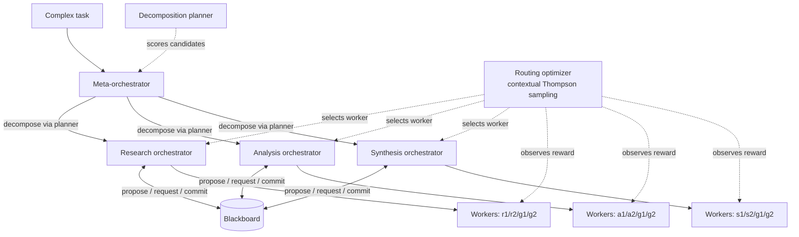
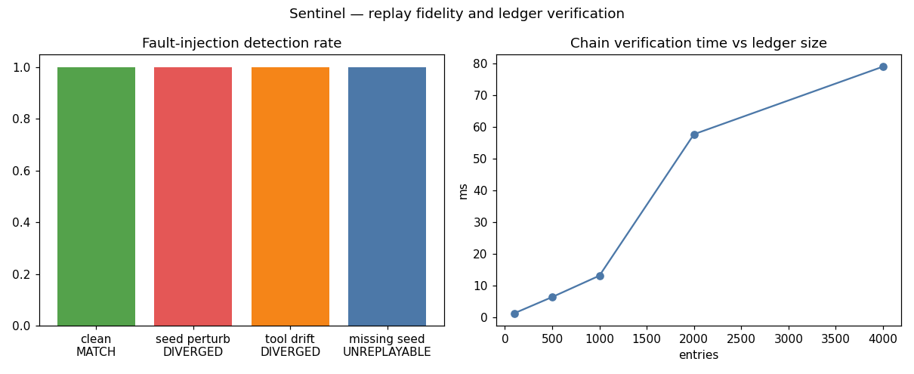

# Meridian — Multi-Orchestrator Multi-Agent Orchestration

A reference architecture for running **complex, multi-domain agentic work**
under one roof: a **vertical** hierarchy (meta-orchestrator → domain
orchestrators → workers) for decomposition and accountability, a
**horizontal** peer-coordination layer (blackboard) so domains can resolve
dependencies without escalating, and an **online decision optimizer** that
learns the best routing policy instead of relying on hand-tuned rules.

## The problem

A single orchestrator becomes a bottleneck on complex tasks: it must
understand every domain, its routing decisions are one-size-fits-all, and
every cross-domain dependency funnels through it. Flat agent swarms have the
opposite problem — no structure, no accountability, expensive coordination.
Production agentic systems need both: hierarchy for decomposition, peer
coordination for speed, and routing that adapts as the workload shifts.

## Architecture



**Vertical layer** (`src/orchestrators.py`): the meta-orchestrator decomposes a
task into per-domain subtasks; each domain orchestrator executes its
subtasks with its worker fleet and aggregates.

**Horizontal layer** (`src/blackboard.py`): domain orchestrators publish
intermediate artifacts and request peer artifacts through a typed
propose/request/commit protocol. Every peer-resolved handoff is an
*escalation avoided* — the meta-orchestrator never sees it.

**Worker fleet** (`src/agents.py`): 8 simulated workers across 3 domains × 2
model tiers (standard/pro). Specialists beat generalists on matched work;
the pro tier holds quality on hard subtasks at ~3× the cost.

## Decision optimization (`src/optimizer.py`)

Two cooperating pieces:

**1. Contextual Thompson-sampling router.** Each dispatch picks a worker to
maximize a scalarized multi-objective reward:

```
r = w_q·quality − w_c·(cost/c₀) − w_l·(latency/l₀) + bonus(quality ≥ 0.70)
```

A separate bandit per (task-kind, difficulty-bin) context learns online.
Two design choices keep it safe and sample-efficient:

- *Model-based priors*: bandits warm-start from worker-profile priors, so one
  unlucky early pull can't lock an arm out; observations refine the prior.
- *Difficulty-gated arm sets*: hard subtasks exclude generalist arms
  entirely — exploration is free where failure is cheap, constrained where
  failure is expensive.

**2. Decomposition planner.** Scores candidate decompositions (medium vs.
medium + peer-review) by *expected task-level reward* built from the
router's learned per-arm component means, mirroring the system's aggregation
model (fan-out loss, failure drag, partial parallelism). Peer review is only
taken when the estimates say it pays.

## Experiments

`experiments/run_experiments.py` — 240-task seeded benchmark, five
architectures:

| Config | What it is |
|---|---|
| A: single | One orchestrator, fixed worker mapping |
| B: vertical | Meta + domain orchestrators, fixed mapping |
| C: vertical+horizontal | B + blackboard peer coordination |
| C+: +hand-tuned tiers | C + hand-written "pro tier for hard subtasks" rule |
| D: meridian (full) | C + learned router + planner |



Full table: [results/results.md](results/results.md).

## Results & conclusions

| Config | Success | Mean quality | Cost/task | Latency/task |
|---|---|---|---|---|
| A: single | 80.4% | 0.742 | $0.124 | 8.1s |
| B: vertical | 70.8% | 0.723 | $0.113 | 6.8s |
| C: vertical+horizontal | 74.2% | 0.732 | $0.088 | 5.5s |
| C+: +hand-tuned tiers | 88.8% | 0.779 | $0.168 | 6.5s |
| **D: meridian (full)** | **89.6%** | **0.791** | **$0.179** | 7.0s |

*(95% CIs in results.md; success = final quality ≥ 0.70; seeded simulation —
see limitations.)*

1. **Hierarchy alone is not enough** (B < A): structure without routing
   intelligence just redistributes the same decisions.
2. **The horizontal layer is the efficiency engine** (C vs B): peer-resolved
   handoffs cut cost and latency — ~175 escalations avoided per 240 tasks —
   but fixed standard-tier routing fails hard subtasks.
3. **Routing intelligence is the quality engine** (C+ vs C): matching worker
   tier to subtask difficulty lifts success from 74% to 89%.
4. **The optimizer discovers the hand-tuned policy on its own** (D vs C+):
   89.6% vs 88.8% success with zero hand-tuning — and it keeps adapting
   online (see the learning curve in charts.png), which a fixed rule
   cannot do.

## Run it

```bash
cd 01-meridian-orchestration
python3 experiments/run_experiments.py   # regenerates results/results.md + charts.png
python3 -c "import sys; sys.path.insert(0,'tests'); import test_smoke; [getattr(test_smoke,n)() or print(n,'OK') for n in dir(test_smoke) if n.startswith('test_')]"
```

Requires: Python 3.10+, `numpy`, `matplotlib`.

## Limitations

Workers and tasks are simulated with seeded RNG — the benchmark measures
*architectural* tradeoffs (coordination topology × routing policy), not
production model behavior. The scalarized weights (w_q=1.0, w_c=0.6,
w_l=0.25, success bonus 1.0) encode one operating point; the optimizer
adapts to whatever weights you set.

## What I'd build next

- Real tool-calling workers behind the same interfaces (the simulation is
  swappable: `WorkerAgent.execute` is the seam).
- Non-stationary bandits (sliding windows) for drifting worker performance.
- A cost-aware planner that also chooses *model* per subtask, not just tier.
