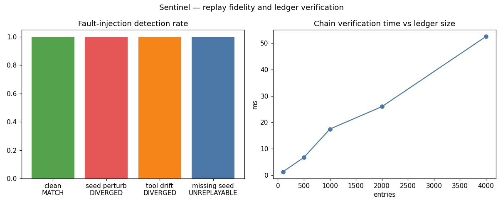

# Sentinel — Deterministic Replay & Evidence Ledger for Agent Decisions

Tamper-evident, replayable audit for agentic systems: every decision is
hash-chained into an append-only ledger, and a replay engine can
reproduce any decision bit-for-bit — or prove exactly where it diverged.

## The problem

Regulated deployments (finance, health, government) must answer *"why did
the agent do that?"* months after the fact — and the answer has to be
*reproducible*. Three things break naive audit logs:

1. **Sampling nondeterminism** — the seed isn't recorded, so the "same"
   decision can't be reproduced.
2. **Tool drift** — the replay calls live tools whose results changed.
3. **Silent tampering** — someone edits the log and nobody can tell.

## Architecture

```mermaid
flowchart LR
    A[Agent decision] --> L[EvidenceLedger.append]
    L --> E[DecisionRecord\nsealed with SHA-256\nchained to prev_hash]
    E --> V[Verifier\nO(n) chain walk]
    E --> R[ReplayEngine]
    R --> C[Tool cassette\nrecorded results, not live calls]
    R -->|output_hash == recorded| M[MATCH]
    R -->|differs| D[DIVERGED\n+ first diverging step]
    R -->|no seed| U[UNREPLAYABLE\ngovernance finding]
```

**Ledger** (agentic_systems/sentinel/ledger.py`): each `DecisionRecord` carries `inputs_hash`,
`policy_version`, `model_params` (including the seed), the tool-call
cassette (name + args/result hashes), and `output_hash`, sealed with
SHA-256 and chained to the previous entry. `verify_chain()` re-seals every
entry and checks every link.

**Replay** (agentic_systems/sentinel/ledger.py::ReplayEngine`): re-executes the decision with the
recorded seed/params against the recorded tool cassette — never live tools —
and compares output hashes. Stepwise executors additionally localize the
first diverging step.

## Experiments

`experiments/run_experiments.py`:

| Scenario | n | Result |
|---|---|---|
| Clean replay | 600 | **100.0% MATCH** (0.07 ms/decision) |
| Seed perturbed (+1) | 150 | 100.0% DIVERGED |
| Tool result mutated | 150 | 100.0% DIVERGED, 100% step-located |
| Seed stripped | 150 | 100.0% UNREPLAYABLE |
| Ledger entry forged | 1 | detected at index 100 |

Chain verification scales linearly: 4,000 entries verify in ~54 ms.



Full table: [results/results.md](results/results.md).

## Results & conclusions

1. **Determinism is a recording problem, not a model problem.** With seed +
   params + tool cassette captured, replay is exact (600/600).
2. **Every realistic failure mode is caught.** Seed loss, tool drift, and
   log tampering each produce a distinct, actionable verdict — including
   *where* the divergence started.
3. **Missing seeds are a first-class finding.** `UNREPLAYABLE` turns "we
   can't reproduce this" from a shrug into a governance event.
4. **Verification is cheap enough to run continuously** — linear, tens of
   milliseconds for thousands of decisions.

## Run it

```bash
cd 02-sentinel-ledger
python3 experiments/run_experiments.py   # regenerates results/results.md + charts.png
```

Requires: Python 3.10+, `matplotlib`.

## Limitations

The agent here is simulated; a production integration needs the host
framework to expose per-step hashes and a real tool cassette. The ledger is
in-memory — a deployment would back it with an append-only store (WORM
bucket, ledger database).

## What I'd build next

- Merkle-tree checkpoints for O(log n) inclusion proofs to auditors.
- Policy-version pinning: refuse replay when the policy bundle changed.
- Real-time divergence alerts wired into the orchestrator's human gates.
