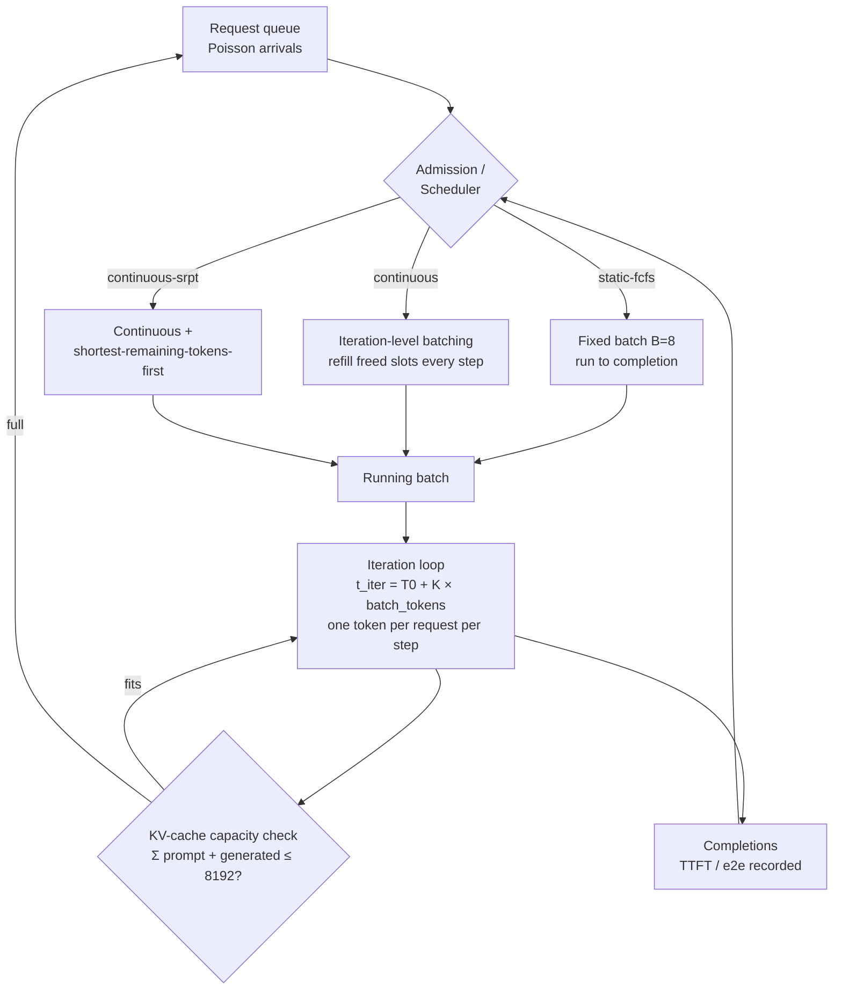
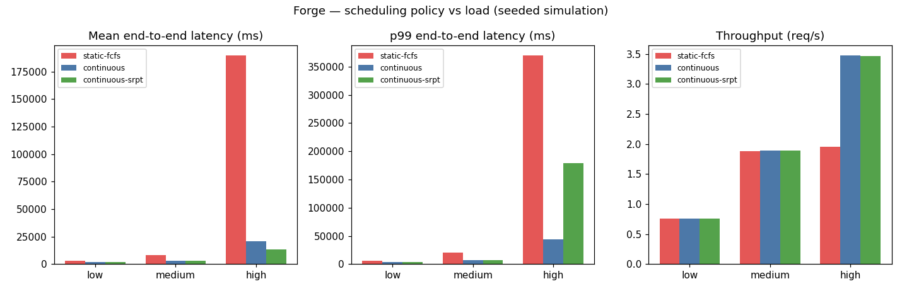

# Forge — LLM Inference Serving Optimizer

Serving concurrent LLM requests on GPUs is a scheduling problem: requests
arrive unpredictably with wildly different prompt and generation lengths,
and naive static batching — fill a batch, run it to completion, repeat —
leaves the GPU idle while long requests block the queue and wastes KV-cache
capacity on padding. Forge is a discrete-event simulator of an inference
serving engine that quantifies how much scheduling policy matters, comparing
static batching against iteration-level continuous batching and
shortest-remaining-time admission under controlled load.

## Architecture



**Simulator model** (agentic_systems/forge/simulator.py`): time advances in iterations; each
iteration every running request generates one token at cost
`t_iter = T0 + K·batch_tokens` (T0 = 10 ms, K = 0.004 ms/token). The KV
cache holds 8,192 tokens; a request occupies `prompt_len + generated_so_far`.
Prefill of a length-P prompt costs `ceil(P / 512)` iterations. No
preemption: a request that doesn't fit waits in the queue.

## The three policies

- **static-fcfs** — the naive baseline: take up to 8 queued requests in
  arrival order, run the whole batch to completion, then start the next.
- **continuous** — vLLM-style iteration-level batching: every iteration,
  completed requests leave and waiting requests are admitted in arrival
  order while KV capacity allows. No batch ever "ends".
- **continuous-srpt** — continuous batching, but admission is ordered by
  shortest remaining tokens first, favoring quick requests to cut queueing.

## Experiments

`experiments/run_experiments.py` — 1,500 requests per cell, seed 42.
Poisson arrivals at 0.8 / 2.0 / 4.0 req/s (low / medium / high load);
prompt lengths uniform 64–512 tokens, generation lengths uniform 32–256;
KV-cache cap 8,192 tokens.



Full table: [results/results.md](results/results.md).

## Results

| Load | Policy | Mean e2e (ms) | p99 e2e (ms) | Mean TTFT (ms) | Throughput (rps) | KV util |
|---|---|---|---|---|---|---|
| low (0.8 rps) | static-fcfs | 2973 | 6192 | 1070 | 0.76 | 7% |
| low (0.8 rps) | continuous | 2017 | 4219 | 18 | 0.76 | 9% |
| low (0.8 rps) | continuous-srpt | 2017 | 4219 | 18 | 0.76 | 9% |
| medium (2 rps) | static-fcfs | 8308 | 20144 | 5642 | 1.88 | 21% |
| medium (2 rps) | continuous | 2857 | 6633 | 28 | 1.89 | 22% |
| medium (2 rps) | continuous-srpt | 2857 | 6633 | 28 | 1.89 | 22% |
| high (4 rps) | static-fcfs | 189503 | 369406 | 186770 | 1.95 | 23% |
| high (4 rps) | continuous | 20607 | 44399 | 14431 | 3.47 | 98% |
| high (4 rps) | continuous-srpt | 13652 | 178710 | 7506 | 3.46 | 96% |

## Conclusions

1. **Continuous batching dominates at high load.** At 4 rps it delivers
   9.2× lower mean latency (20,607 ms vs 189,503 ms) and 1.8× the
   throughput (3.47 vs 1.95 rps) of static batching. The mechanism is
   visible in KV utilization: static batching idles the GPU at 23% while
   head-of-line blocking starves the queue; continuous batching keeps the
   cache 98% full.
2. **At low and medium load, policy barely matters.** Throughput is
   identical across policies (0.76 / ~1.89 rps) and SRPT is exactly equal
   to plain continuous batching — admission order only matters once there
   is real queueing pressure.
3. **SRPT is a mean-vs-tail tradeoff.** At high load it cuts mean latency
   34% (13,652 ms vs 20,607 ms) and TTFT ~48% (7,506 ms vs 14,431 ms), but
   p99 explodes to 178,710 ms vs 44,399 ms — classic starvation of long
   requests. Production SRPT needs anti-starvation (e.g. aging or a
   wait-time cap).
4. **TTFT is the most policy-sensitive metric.** Even at low load,
   continuous batching answers the first token in 18 ms vs 1,070 ms for
   static — a 59× gap from scheduling alone, before any model optimization.

## Run it

```bash
cd 03-forge-inference
python3 experiments/run_experiments.py   # regenerates results/results.md + charts.png
```

Requires: Python 3.10+, `matplotlib`.

## Limitations

- The iteration-cost model is linear (`T0 + K·batch_tokens`); real
  attention is closer to quadratic in sequence length and memory-bandwidth
  bound in decode.
- No preemption or KV-cache eviction: an admitted request always runs to
  completion, which flatters static batching's tail slightly and understates
  continuous batching's advantage under memory pressure.
- No tensor/pipeline parallelism, no chunked prefill, no speculative
  decoding — single-replica, single-stream serving only.

## What I'd build next

- Chunked prefill and preemption with KV-cache eviction/recompute, to
  model the full vLLM scheduling policy space including prefill/decode
  disaggregation.
- A cost model mapping tokens → GPU-hours, so the scheduler can optimize
  latency *and* cost per request (the missing half of the serving tradeoff).
- Trace-driven workloads (burst patterns from real serving logs) instead of
  Poisson arrivals, to test policies against production-like traffic shapes.
