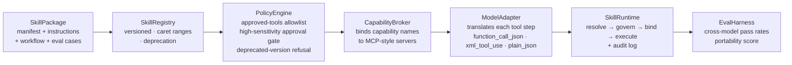
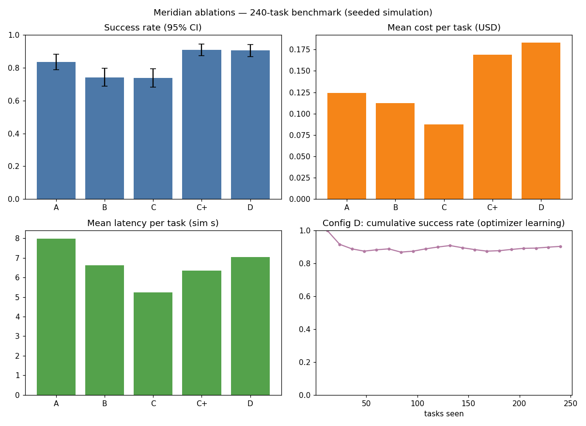

# SkillBridge MCP — A Model-Agnostic Framework for Reusable AI Skills

## Problem

The rapidly evolving AI ecosystem is creating fragmentation in how skills, instructions, tools, and workflows are developed and deployed across different large language models (LLMs) and agent frameworks. Skills are frequently coupled to specific model providers, prompting conventions, tool-calling interfaces, and orchestration runtimes, resulting in duplicated engineering effort, vendor lock-in, inconsistent behavior, and increased maintenance costs. Although the Model Context Protocol (MCP) standardizes access to tools and contextual resources, it does not, by itself, provide a complete solution for packaging, executing, governing, and evaluating portable skills across heterogeneous AI environments.

## Solution

SkillBridge MCP proposes a unified, model-agnostic framework for defining, discovering, sharing, executing, and governing reusable AI skills across multiple LLMs and agent runtimes. It combines portable skill definitions, MCP-based capability discovery and tool integration, standardized interfaces, model adapters, and a common execution and evaluation layer. Skills can encapsulate domain knowledge, instructions, workflows, and references to approved tools while remaining independent of any particular model provider. A centralized registry, version management, security policies, and cross-model evaluations enable organizations to develop a skill once and deploy it consistently across supported AI platforms, accelerating reuse, improving portability, reducing engineering costs, and minimizing vendor dependency.

## Architecture



A skill is written once against *capability names* (`text.extract`, `code.lint`),
never provider APIs. At run time the registry resolves the version, the policy
engine governs the run, the broker binds capabilities to MCP-style servers, and
the model adapter translates each tool step into the provider's own calling
convention. The same skill package runs on every supported model; the
evaluation harness measures how consistently.

## Components

- `src/skill.py` — provider-neutral skill definition: manifest, instruction template, capability-referencing workflow, executable eval cases.
- `src/registry.py` — versioned registry with exact / caret (`^1.2.0`) / latest resolution and deprecation semantics.
- `src/capabilities.py` — MCP-style capability broker binding capability names to server implementations; a skill only runs when every requirement resolves.
- `src/adapters.py` — model adapters translating portable tool steps into provider conventions (`function_call_json`, `xml_tool_use`, `plain_json`), each with a quality/cost profile.
- `src/policy.py` — governance: approved-tools allowlist, high-sensitivity approval gate, deprecated-version refusal. Denials are returned, not thrown, so they can be counted.
- `src/runtime.py` — executes skills through resolve → govern → bind → execute, emitting a per-step audit log that records the translated call.
- `src/eval.py` — cross-model harness: per-adapter pass rates, cross-adapter std dev, worst-adapter portability score.
- `src/catalog.py` — 6 sample skills, deterministic tool servers, transforms with adapter-modulated corruptors, 132 executable eval cases.

## The effective-quality model (documented assumption)

Adapters carry simulated quality profiles; a transform step is corrupted with
probability `(1 − q_eff) · err_rate`, where:

```
q_eff = 0.60 + 0.40 · q_adapter  (+ N(0, 0.015))   # SkillBridge mode
q_eff = q_adapter                (+ N(0, brittleness))  # raw baseline
```

The assumption being modeled: a skill's standardized instructions and workflow
constrain the model, *damping* provider differences; ad-hoc per-provider
prompting exposes the full provider variance plus prompt brittleness.
Standardization can't make a weak model strong — it reduces variance. The
packaging, governance, and evaluation machinery is real code; the quality
curves are the stated simulation on top.

## Experiments

`experiments/run_experiments.py` — three experiments, seeded and reproducible.

### Exp 1 — Portability: 6 skills × 3 adapters × 2 modes

Same skills, same 132 inputs; only the adapter (and mode) changes. Adapters:
`openai-style` (function_call_json), `anthropic-style` (xml_tool_use),
`local-style` (plain_json).

| Skill | Mode | openai-style | anthropic-style | local-style | Mean | Worst | Std |
|---|---|---|---|---|---|---|---|
| invoice-extractor | skillbridge | 100% | 100% | 100% | 100% | 100% | 0.000 |
| invoice-extractor | raw | 100% | 100% | 100% | 100% | 100% | 0.000 |
| pii-redactor | skillbridge | 92% | 92% | 79% | 88% | 79% | 0.059 |
| pii-redactor | raw | 88% | 88% | 54% | 76% | 54% | 0.157 |
| sql-generator | skillbridge | 100% | 100% | 79% | 93% | 79% | 0.098 |
| sql-generator | raw | 100% | 96% | 67% | 88% | 67% | 0.148 |
| code-reviewer | skillbridge | 100% | 96% | 88% | 94% | 88% | 0.052 |
| code-reviewer | raw | 96% | 88% | 71% | 85% | 71% | 0.104 |
| meeting-summarizer | skillbridge | 96% | 96% | 92% | 94% | 92% | 0.020 |
| meeting-summarizer | raw | 83% | 92% | 79% | 85% | 79% | 0.052 |
| rag-answerer | skillbridge | 100% | 83% | 96% | 93% | 83% | 0.071 |
| rag-answerer | raw | 88% | 79% | 54% | 74% | 54% | 0.142 |

Mean cross-adapter std: **0.050 (SkillBridge) vs 0.100 (raw)** — halved.

### Exp 2 — Reuse economics (analytical model, dev-days)

`baseline(M) = S·M·E` (every skill rebuilt per provider) vs
`bridge(M) = S·E + M·A + F` (skills once + one adapter per model),
with S=20 skills, E=5d, A=8d, F=15d:

| Models | Per-provider rebuild | SkillBridge | Saved |
|---|---|---|---|
| 1 | 100 | 123 | −23 |
| 2 | 200 | 131 | 69 |
| 3 | 300 | 139 | 161 |
| 4 | 400 | 147 | 253 |
| 5 | 500 | 155 | 345 |
| 6 | 600 | 163 | 437 |
| 7 | 700 | 171 | 529 |
| 8 | 800 | 179 | 621 |

### Exp 3 — Governance (adversarial runs)

| Scenario | Result |
|---|---|
| Tool not in `approved_tools` | DENIED — capability 'text.scan_pii' not in approved_tools |
| High-sensitivity tool, no approval | DENIED — capability 'data.export' is high-sensitivity: approval required |
| High-sensitivity tool, with approval | ALLOWED |
| Deprecated version `sql-generator@0.5.0` | DENIED — sql-generator@0.5.0 is deprecated |

Adversarial runs denied: **3/3**; clean runs allowed: **20/20**.



Full tables: [results/results.md](results/results.md).

## Results & conclusions

1. **Standardization halves cross-provider variance** (mean std 0.050 vs 0.100) and lifts worst-adapter pass rates substantially — e.g. pii-redactor on local-style goes 54% → 79%, rag-answerer 54% → 96%.
2. **It damps but does not eliminate provider differences**: the weakest adapter still trails on code-heavy skills (sql-generator 79%, code-reviewer 88% vs 100% on frontier adapters). A skill framework is not a model upgrade.
3. **Deterministic tool steps are portable by construction**: invoice-extractor passes 100% on every adapter in both modes (0.000 std) — the framework's value concentrates in model-reasoning steps, which is exactly where the variance lives.
4. **Economics favor SkillBridge from the second model on**: it costs 23 extra dev-days for a single model, then saves 69+ days per additional model (345 days at 5 models under the stated model).
5. **Governance is airtight in the test battery**: 3/3 adversarial runs denied with specific reasons, 20/20 clean runs allowed — zero false positives.
6. **Caveat**: the portability magnitudes rest on the documented damping assumption. What the code genuinely demonstrates is the machinery — packaging, versioned registry, capability binding, policy enforcement, and cross-model evaluation — which is provider-independent regardless of the quality curves.

## Run it

```bash
cd 04-skillbridge-mcp
python3 experiments/run_experiments.py   # regenerates results/results.md + charts.png
```

Requires: Python 3.10+, `matplotlib`.

## Limitations

- Adapters are simulated quality/cost profiles, not live provider APIs; the variance-reduction magnitudes depend on the documented damping assumption.
- Capability servers are in-process; production needs real MCP servers over the network with authentication.
- The corruption model is synthetic (one corruptor per transform); real model failure modes are more varied.

## What I'd build next

- Live adapters for real provider APIs behind the same `ModelAdapter` interface, re-running the portability battery against measured (not simulated) quality.
- Signed skill packages + registry transparency log for supply-chain integrity.
- Portability drift tracking: re-run eval on every provider model update and alert when cross-model variance regresses.
