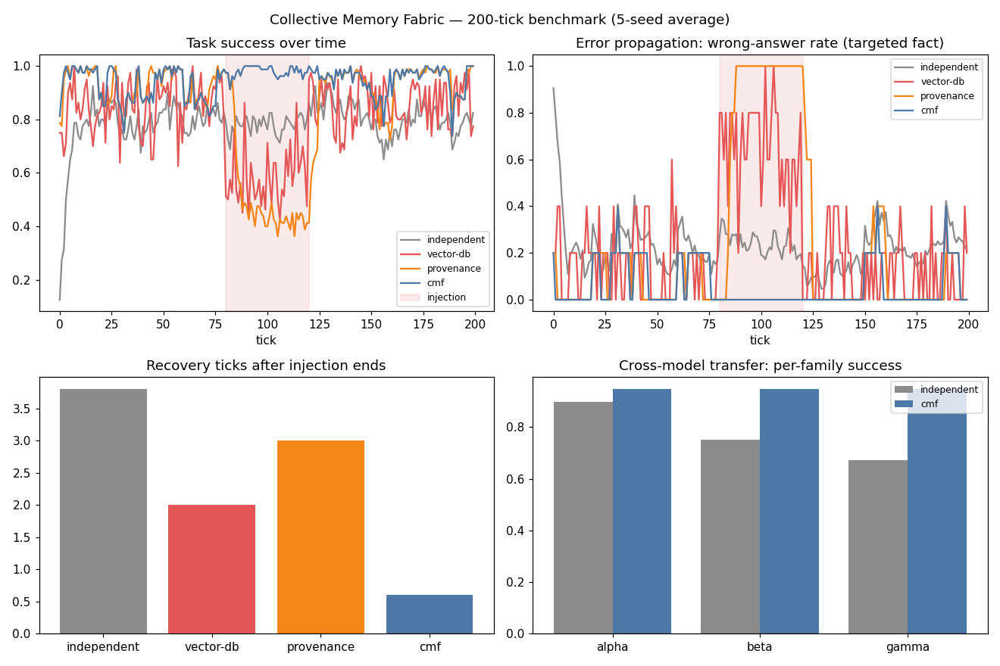

# Collective Memory Fabric (CMF) — A Model-Agnostic Collective Memory Protocol for Multi-Agent AI Systems

## Research problem

The rapid evolution of multi-agent AI systems is creating a fundamental
challenge: how can autonomous agents, potentially powered by different
large language models (LLMs), reliably share knowledge, learn from one
another's experiences, and maintain a consistent understanding of the world
over extended periods? Existing approaches commonly rely on shared
databases, vector retrieval, knowledge graphs, or conversation histories.
However, shared storage alone does not ensure that information contributed
by different agents is trustworthy, consistent, current, or appropriate for
every recipient. An incorrect inference from one agent can propagate
throughout the system, while conflicting observations, outdated knowledge,
and incompatible model behaviors can undermine collective performance.

## Proposed approach

A Collective Memory Fabric (CMF): a model-agnostic protocol and
architecture that enables heterogeneous AI agents to establish and maintain
reliable shared memory. Memories are structured, versioned **claims**
carrying supporting evidence, provenance, temporal validity, calibrated
confidence, and access policies. The framework provides mechanisms for
memory admission, semantic conflict detection, reconciliation, selective
propagation, expiration, and correction/revocation. Built on interoperable
interfaces (claims serialize as MCP-style resources), CMF lets agents using
different LLMs, tools, and orchestration frameworks exchange knowledge
without depending on a particular model provider or storage technology.
The central idea: treat collective memory as a **governed, evolving
knowledge system**, not an unstructured repository of agent text.

## Architecture

```mermaid
flowchart TB
    A1[Agent α] -->|propose claim| AD[Admission gate\nconfidence + evidence checks]
    A2[Agent β] -->|propose claim| AD
    A3[Agent γ] -->|propose claim| AD
    AD -->|same value| MG[Merge: strengthen evidence]
    AD -->|new value, no conflict| AC[Admit as active]
    AD -->|conflicting value| CD[Conflict detection\nsame subject+predicate,\noverlapping validity]
    CD --> RC[Reconciliation\nscore = confidence × recency ×\n(1 + 0.25 × distinct agents)]
    RC -->|winner| AC
    RC -->|loser| SP[Superseded tombstone\nkept for audit]
    AC --> Q[Query: active claim,\nvalid at time t]
    AC --> SW[Sweeper: expire\npast valid_until]
    AC --> RV[Revocation: quorum\nof 2+ agents or author]
    Q --> MCP[MCP resource\ncmf://claims/id]
```

**Claim** (`src/memory.py`): `(subject, predicate, value)` plus confidence,
evidence as `(agent_id, ts)` pairs, provenance, validity window, version,
status (`active | superseded | revoked | expired | rejected`), and access
policy. Nothing is ever deleted — superseded and revoked claims persist as
tombstones, so the fabric can explain *why* it believes what it believes.

**Reconciliation** is the core innovation. Claim strength is

```
score = confidence × (0.5 + 0.5 × recency) × (1 + 0.25 × distinct_agents)
```

where `distinct_agents` counts *independent observers* inside the quorum
window — not raw evidence items. One loud agent, however confident, cannot
outvote several independent ones. Fresh confirmations refresh a claim's
validity and recency (merge path), so living knowledge doesn't go stale
while abandoned knowledge decays and loses.

## Experiments

`experiments/run_experiments.py` — 200 ticks, 8 agents across 3 model
families (α 0.95 / β 0.85 / γ 0.72), 10 facts flipping over time, one
compromised agent injecting a fixed false claim 2×/tick at 0.95 confidence
during ticks 80–120 (Sybil-style: high frequency, single source). Same
seeded observation schedule replayed into all four systems; 5-seed averages.

| System | Mean success | During injection | Targeted wrong rate | Recovery |
|---|---|---|---|---|
| independent (no sharing) | 78.7% | 77.9% | 24.3% | 3.8 ticks |
| vector-db (last-write-wins) | 80.2% | 57.9% | 66.0% | 2.0 ticks |
| provenance (majority vote) | 84.0% | 50.7% | 86.0% | 3.0 ticks |
| **cmf (full fabric)** | **94.7%** | **98.0%** | **0.0%** | 0.6 ticks |

Cross-model transfer (per-family task success): γ-family agents rise from
69.1% (independent) to 94.5% (CMF) — weaker models benefit most from
governed sharing. Contradiction rate in CMF: 0.000. Op cost: 0.23 ms/tick.



Full table: [results/results.md](results/results.md).

## Results & conclusions

1. **Explicit consistency mechanisms work.** CMF holds 98% task success
   *during* an active misinformation attack with a 0% wrong-answer rate on
   the targeted fact; every baseline degrades.
2. **Evidence-aware admission stops error propagation.** The attacker's
   high-confidence claims lose every reconciliation: one source can never
   outvote independent observers (distinct-agent quorum).
3. **Naive "wisdom of the crowd" is Sybil-vulnerable.** Majority-vote
   provenance performs *worst* under attack (86% wrong) — the attacker's
   2 claims/tick outvote ~1.6 honest observations/tick. Counting *sources*,
   not *claims*, is the fix.
4. **Model-agnostic sharing transfers knowledge across model families.**
   The weakest family (γ, 0.72) reaches 94.5% under CMF vs 69.1% alone —
   the fabric, not the model, carries the reliability.
5. **Robustness has a real, bounded cost:** fact flips converge in ~5–8
   ticks (the price of demanding corroboration), and reconciliation costs
   ~0.2 ms/tick vs ~0.04 ms for last-write-wins.

## The three research questions, answered

- *Do explicit consistency mechanisms reduce contradictory/outdated
  knowledge?* Yes — contradiction rate 0.000; expiry + supersede tombstones
  keep the store current.
- *Do evidence-aware admission and correction limit error propagation?*
  Yes — 0.0% targeted wrong rate under sustained injection; revocation
  quorum available for anything that slips through.
- *Does model-agnostic sharing improve task performance across LLM
  families?* Yes — all three families converge to ~94–95% regardless of
  individual accuracy.

## Run it

```bash
cd 05-collective-memory-fabric
python3 experiments/run_experiments.py   # regenerates results/results.md + charts.png
python3 -c "import sys; sys.path.insert(0,'tests'); import test_smoke; [getattr(test_smoke,n)() or print(n,'OK') for n in dir(test_smoke) if n.startswith('test_')]"
```

Requires: Python 3.10+, `matplotlib`.

## Limitations

Agents, observations, and the attacker are simulated with seeded RNG — the
benchmark measures *protocol* behavior (admission, reconciliation,
propagation dynamics), not production model behavior. Claims use a simple
`(subject, predicate, value)` schema; rich semantic conflict detection
(embedding-based near-duplicate/contradiction) is future work. The quorum
window and scoring weights are fixed; adaptive tuning is open research.

## What I'd build next

- Semantic conflict detection via embeddings for non-identical predicates.
- Merkle-checkpointed claim chains for auditor-friendly inclusion proofs.
- Adaptive quorum windows driven by observed flip rates per subject.
- A live MCP server implementation of `to_mcp_resource` for real agents.
