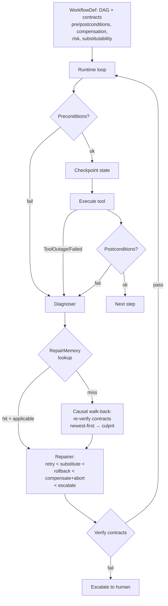
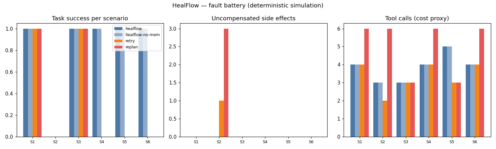

# HealFlow — A Model-Agnostic, Self-Healing Runtime for Agentic Workflows

## Research problem

As AI agents increasingly execute complex, multi-step workflows involving
external tools, APIs, databases, and other agents, failures arise from
unavailable services, malformed outputs, incorrect intermediate reasoning,
changing dependencies, inconsistent shared memory, and partially completed
actions. Existing approaches often rely on retries, predefined fallback
mechanisms, or LLM-driven replanning, which may address individual failures
without identifying their root causes or ensuring that the repaired
workflow remains correct. A failed recovery can introduce additional
errors, repeat costly operations, or leave external systems in an
inconsistent state.

## Proposed solution

HealFlow is a model-agnostic, self-healing runtime that lets agentic
workflows recover autonomously while preserving execution integrity.
Workflows are dependency-aware graphs with explicit preconditions,
postconditions, checkpoints, and verification rules. On failure, the
runtime diagnoses the likely cause, determines the affected components,
selects the *smallest viable repair*, and verifies the outcome before
resuming. Transaction-aware recovery — rollback, compensating actions,
bounded retries, human approval for high-risk operations — keeps a bad
repair from cascading. Standardized interfaces (MCP-style tool contracts)
keep recovery logic independent of any model provider.

The research contribution is the combination of **causal failure
diagnosis**, **safe dependency-aware repair**, and a **persistent repair
memory** that reuses validated recovery strategies across workflows.

## Architecture



**Diagnosis** (agentic_systems/healflow/diagnosis.py`): classifies the failure (transient /
persistent outage, schema change, bad intermediate, precondition
violation), then walks the completed steps newest-first re-verifying
contracts. The first step whose contract is violated is the *culprit* —
the repair targets the cause, not the symptom.

**Repair memory** (agentic_systems/healflow/repair.py`): validated `(failure-signature →
repair)` pairs keyed by *failure shape* — `('exception','ToolOutage',first?)`,
`('postcondition','schema'|'data',first?)` — never by workflow or model, so
strategies transfer across both. A repair is recorded only after its
step's contracts verify.

## Experiments

`experiments/run_experiments.py` — deterministic fault-injection battery.

**Phase 1** — 6 scenarios × 4 systems (healflow, healflow-no-memory, naive
retry, llm-replan):

| Scenario | healflow | retry | replan |
|---|---|---|---|
| order: transient payment outage | ✅ (retry×2) | ✅ | ✅ (6 calls — wasteful restart) |
| order: inventory permanently down | 🛟 graceful abort, 0 side effects | ❌ 1 side effect (charged, no refund) | ❌ **3 side effects** (triple charge) |
| etl: transient extract outage | ✅ | ✅ | ✅ |
| etl: upstream schema change | ✅ (substitute) | ❌ | ❌ |
| research: permanent plan corruption | ✅ (rollback → substitute) | ❌ | ❌ |
| research: search schema change | ✅ (substitute) | ❌ | ❌ |

Diagnosis accuracy: 6/6 for HealFlow. Side effects: HealFlow 0, retry 1,
replan 3.

**Phase 2 — repair-memory transfer**: train on the etl schema change, test
on the analogous research schema change. With memory: 1 diagnosis step
(memory hit), success. Without: 2 steps, full re-diagnosis. The validated
strategy transfers across workflows with zero re-derivation.



Full table: [results/results.md](results/results.md).

## Results & conclusions

1. **Diagnosis beats repetition.** Retry and replan succeed on transient
   faults but fail every structural fault (schema change, permanent
   corruption) — they re-execute the symptom instead of finding the cause.
2. **Unsafe recovery is worse than no recovery.** Replanning a payment
   workflow triple-charges the customer; naive retry leaves a charge with
   no refund. HealFlow's compensate-then-abort terminates gracefully with
   zero side effects — the only safe autonomous outcome when repair is
   impossible.
3. **Smallest-viable-repair generalizes.** The same policy (retry <
   substitute < rollback < compensate < escalate) handles outages, schema
   drift, and corrupted intermediates across three unrelated workflows,
   with verification gating every step.
4. **Repair memory transfers.** A strategy validated on one workflow
   applies to an analogous failure on another in a single lookup —
   model-agnostic and workflow-agnostic by construction (keyed by failure
   shape).
5. **Failed verification must escalate, not cascade.** Bounded retries +
   no-repeat guards ensure the runtime asks for help instead of looping —
   every HealFlow run either succeeded, aborted gracefully, or escalated.

## Run it

```bash
cd 06-healflow
python3 experiments/run_experiments.py   # regenerates results/results.md + charts.png
python3 -c "import sys; sys.path.insert(0,'tests'); import test_smoke; [getattr(test_smoke,n)() or print(n,'OK') for n in dir(test_smoke) if n.startswith('test_')]"
```

Requires: Python 3.10+, `matplotlib`.

## Limitations

Tools, faults, and workflows are simulated deterministically — the
benchmark measures *recovery-protocol* behavior, not production incidents.
The diagnoser's cause taxonomy is fixed; truly novel failure modes still
escalate (by design). Human approval for high-risk repair is modeled as
escalation, not an interactive gate.

## What I'd build next

- Learned cause classifier over failure embeddings (beyond the fixed taxonomy).
- Partial-order rollback: replay only the affected subgraph, not the linear prefix.
- A live MCP tool-wrapper so real agents get checkpoints/contracts for free.
- Repair-memory sharing across agents via the Collective Memory Fabric (project 5).
