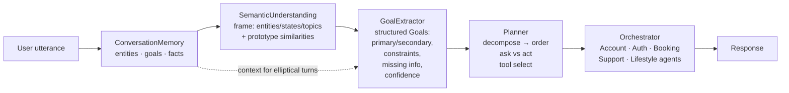
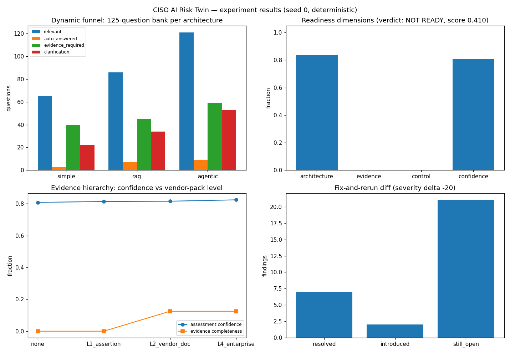

# Intent Inference — Why ChatGPT Doesn't Classify Intents

## Research problem

Traditional chatbots treat language understanding as classification:
utterance → one predefined intent label → dialogue manager → API call.
This breaks in exactly the situations real conversations produce:
paraphrases with low lexical overlap ("Can you tell me whether I can
afford lunch today?"), multiple intents in one utterance ("I forgot my
password, but I also changed my phone number, and I can't receive OTP"),
implicit goals ("I'm hungry"), intent that evolves across turns ("I have
an interview tomorrow" … "What should I wear?"), and utterances whose
meaning exists only in context ("Book me a hotel" … "Make it cheaper").
A single label cannot represent any of these, and a stateless router
cannot resolve the last two at all.

## Proposed solution

A ChatGPT-style inference pipeline in which **intent is emergent, never
classified**:

```
user text
  → ConversationMemory        (entities, goals, facts across turns)
  → SemanticUnderstanding     (meaning frame: entities/states/topics —
                               no labels)
  → GoalExtractor             (structured goals: primary/secondary,
                               constraints, missing info, confidence)
  → Planner                   (decompose, ask-vs-act, tool selection,
                               delegation to specialists)
  → Orchestrator              (stub agents execute; results synthesized)
```

Key mechanisms: situation prototypes matched in embedding space with
discriminative-term gating (a prototype only fires when its necessary
participants are present); per-clause decomposition for multi-intent
utterances; predicate-level disambiguation ("afford lunch" is about money,
not hunger); evidence-checked missing-info questions (asked only when the
answer is genuinely absent); elliptical-turn inheritance from conversation
memory.  There is no intent-classification module anywhere in this path —
and no utterance can produce "unknown": the worst case is a best-effort
goal plus a clarification question.

## Architecture



**Goal extraction** (`goals.py`): candidates come from prototype matches
gated on discriminative terms, filtered by relative margin, disambiguated
at the predicate level, and — for elliptical turns — inherited from memory
instead of matched from content words.

**Ask-vs-act** (`planner.py`): a question is asked only when its evidence
terms are absent from the utterance. "My Apple laptop screen becomes dark
after login" yields *Is an external monitor connected?* and *Have you
tried safe mode?* — the exact structured output from the concept — while
"Transfer $200 to savings" asks nothing, because the amount and
destination are already present.

## Experiments

`experiments/run_experiments.py` — both architectures graded on a frozen
20-case suite covering six phenomena (seed 7).

| Phenomenon | n | Classifier | Pipeline |
|---|---|---|---|
| paraphrase | 5 | 0.4 | 1.0 |
| multi_intent | 3 | 0.0 | 1.0 |
| latent | 2 | 0.5 | 1.0 |
| dynamic | 1 | 0.0 | 1.0 |
| context | 3 | 0.333 | 1.0 |
| out_of_catalog | 2 | 0.0 | 1.0 |
| standard | 5 | 1.0 | 1.0 |

Aggregate: classifier 45% task success (recall 0.567, precision 0.65);
pipeline 100% (recall 1.0, precision 1.0). Paraphrase consistency 0.42 →
1.0; context accuracy 0.33 → 1.0.



Full table: [results/results.md](results/results.md).

## Results & conclusions

1. **One label cannot hold a conversation.** The classifier is perfect on
   canonical phrasings (5/5) and scores 0% on multi-intent and
   out-of-catalog — structurally, not by accident: a softmax over a fixed
   catalog has nowhere to put three goals or a novel one.
2. **"Unknown" is an architecture failure, not a data gap.** Seven of the
   classifier's turns end in "Sorry, I didn't understand. Please rephrase."
   The pipeline's six clarifications are all targeted missing-info
   questions — a different *kind* of clarification, asked for a reason.
3. **Emergence beats enumeration.** Paraphrases like "afford lunch today"
   resolve through embedding neighborhoods plus predicate disambiguation —
   no training example required. Intent was never a database field here.
4. **Memory is what makes the second turn work.** "Make it cheaper" and
   "What should I wear?" are meaningless as isolated classifications;
   inherited context turns them into `refine_search` and `attire_advice`.
5. **Ask-vs-act needs evidence checks, not confidence thresholds.** Asking
   "how much?" when the user already said "$200" is as bad as never
   asking. The missing-info rules fire only on genuinely absent evidence.

## Run it

```bash
cd 07-intent-inference
python3 experiments/run_experiments.py   # regenerates results/results.md + charts.png
cd ..
python3 examples/07_intent_inference_quickstart.py
cd 07-intent-inference
python3 -c "import sys; sys.path.insert(0,'tests'); import test_smoke; [getattr(test_smoke,n)() or print(n,'OK') for n in dir(test_smoke) if n.startswith('test_')]"
```

Requires: Python 3.10+, `numpy`, `matplotlib`. No sklearn, no model downloads —
the TF-IDF, softmax regression, and semantic space are implemented from scratch.

## Limitations

Stub agents return canned structured outcomes, so the benchmark measures
*architectural* behavior (goal inference, decomposition, memory use), not
production NLU quality. The prototype corpus and lexicons are hand-built;
a production system would learn them. Ambiguity the rules don't cover
(e.g. genuinely ambiguous "it") resolves to the first-ranked reading.

## What I'd build next

- Learned prototype induction from conversation logs (replace hand-written situations).
- Scored clarification policies: expected value of asking vs acting under uncertainty.
- Tool-use grounding: execute against the SkillBridge skill registry (project 4) instead of stubs.
- Remit checks on delegation: hand the pipeline's goals to the remit-governance layer so inferred goals can't exceed the agent's mandate.
