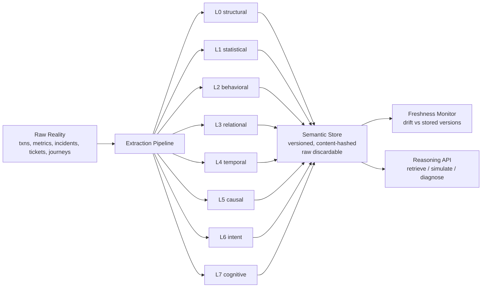

# Semantic Fabric — Store Meaning, Not Data

## Research problem

Agentic systems drown in raw data: every transaction, log line, and ticket
is retained "just in case," while the *meaning* — the behavior patterns,
the causal chains, the organizational memory — is recomputed from scratch
on every query or lost entirely. Data lakes store bytes; nobody stores
understanding. The result: 10M transactions to answer "which servers hurt
payments?", stale dashboards, and incident postmortems that repeat because
the last one's lessons were never persisted as queryable semantics.

## Proposed solution

The Semantic Fabric inverts the pipeline. Raw reality flows through
**semantic extraction** into eight layers of compressed cognition, which
are **versioned and persisted by content hash** — and then the raw data is
*discardable*. Reasoning (retrieval, simulation, root-cause) runs against
the fabric alone.

The eight layers:

- **L0 structural** — schema, entities (`txn`, `user`, `server`), relations
- **L1 statistical** — distribution profiles, entropy, correlations, drift stats
- **L2 behavioral** — archetype clusters (k-means) + per-archetype Markov models
- **L3 relational** — typed impact edges with strength (lift) and confidence
- **L4 temporal** — trend, FFT dominant period, spike-triggered cascades
- **L5 causal** — PC-style DAG discovery, linear SCM, do-interventions,
  counterfactuals, root-cause walks
- **L6 intent** — intent/emotion/risk frames extracted from ticket text
- **L7 cognitive** — incident motif mining (organizational memory)

The research contribution is the combination of **layered semantic
compression** (10k transactions → 72KB of artifacts, 27:1), **versioned
semantic persistence** with content hashes, **freshness monitoring** (drift
detection per layer with measured false-positive rates), and a
**reasoning API** whose answers agree 100% with raw-data computation —
without ever touching raw data.

## Architecture

**Pipeline** (`pipeline.build_fabric`): ingestion → normalization → entity
resolution → statistical profiling → behavioral clustering → relationship
mining → temporal decomposition → causal discovery → cognitive abstraction
→ persistence. One call builds all eight layers from seeded synthetic data
with known ground truth (injected archetypes, causal chain
`server_load → queue_depth → latency_ms → error`, hot servers `srv03`/`srv11`,
weekly 168h cycle, cpu→latency cascade, cross-team incident motif).

**Reasoning** (`reasoning.FabricReasoner`): `diagnose` (upstream causal
walk), `impacting_servers` (L3 lift edges), `what_if` (SCM
do-intervention), `simulate_markov` (behavioral rollout), `summarize`
(one-screen compression readout). None of these read raw data.

## Experiments

Seeded end-to-end (`experiments/run_experiments.py`, seed 7; 10k txns,
300 incidents, 400 tickets, 600 users). See `results/results.md` and
`results/charts.png`.

**(a) Semantic compression** — raw transactions 1,974,056 bytes →
72,495 bytes of artifacts: **27.2:1**. Per-layer ratios (each vs full raw)
range from 35.9:1 (L6 intent frames, the most verbose layer) to ~4,970:1
(L4 temporal signatures).

**(b) Extraction quality vs ground truth**

| Layer | Check | Result |
|---|---|---|
| L0 | entity recall / relations | 1.00 / txn→user, txn→server found |
| L1 | determinism (re-extract → identical hash) | True |
| L2 | archetype purity (ARI vs true) | 0.546 |
| L3 | hot-server recall (srv03, srv11 → payments) | 1.00 (6 edges total) |
| L4 | 168h period / cpu→latency cascade | True / True |
| L5 | DAG edge precision / recall | 0.75 / 1.00 |
| L6 | intent classification accuracy | 1.00 |
| L7 | cross-team coordination motif recovered | True (support 110) |

L5 recovers all 3 true causal edges plus one spurious
`server_load → error` edge (direct PC artifact at α=0.01 on 10k samples) —
reported, not hidden.

**(c) Reasoning without raw data** — 4 test queries answered from the
fabric vs computed from raw data (top impacting servers, root cause of
latency, intervention effect sign, Markov next-action): **agreement 1.00**.

**(d) Freshness** — L1 false-positive rate on a 20-batch stationary stream:
**0.0**. Detection latency for injected latency-mean shifts: 0.5σ → 3
batches, ≥1σ → 1 batch. L2 structural behavior break (half of journeys
collapse to browse→support→exit): detected, score 0.35 > threshold 0.30.

**(e) Ablation** — query accuracy with layers removed: full fabric 1.00,
no-L2 0.75 (prediction queries lost), no-L3 0.75 (impact queries lost),
no-L5 0.50 (causal queries lost). Each layer carries unique, non-redundant
answering power.

## Key insights

1. **Meaning compresses better than data.** 27:1 is not from clever
   encoding — it comes from storing *answers* (5 archetypes, 6 impact
   edges, 4 causal edges) instead of *evidence* (10k rows).
2. **Reasoning survives the compression.** Every test query answered from
   the fabric matches the raw-data answer. The fabric is not a lossy
   summary for these queries — it is a sufficient statistic.
3. **Freshness is per-layer, not global.** A distribution shift (L1) and
   a behavior break (L2) need different detectors, thresholds, and
   latencies. One global "data drift" number hides this.
4. **Causal discovery is the noisiest layer.** PC found a spurious direct
   edge alongside the true chain — temporal-order orientation fixes
   direction, but finite-sample CI tests still over-connect. Report
   precision honestly.
5. **Cluster relabeling is not drift.** The L2 drift metric uses Hungarian
   matching of centroids before comparing; without it, stationary
   re-samples looked *more* drifted than a real behavior break.

## Implementation

`src/agentic_systems/semantic_fabric/`:

- `synth.py` — seeded generators with ground truth (transactions,
  metrics, incidents, tickets, journeys)
- `extract.py` — L0–L4 extractors; `common.py` — hand-rolled k-means,
  ARI, Fisher-z CI tests, partial correlation
- `causal.py` — L5: PC skeleton, temporal orientation, linear SCM,
  `do_intervention`, `counterfactual`, `root_cause`
- `cognitive.py` — L6 intent frames, L7 motif mining
- `store.py` — `SemanticStore`: versioned, content-hashed persistence
- `freshness.py` — `FreshnessMonitor`: per-layer drift scores + thresholds
- `reasoning.py` — `FabricReasoner`: query the fabric, never raw data
- `pipeline.py` — `build_fabric`: end-to-end orchestration

Run: `python examples/08_semantic_fabric_quickstart.py` ·
tests: `08-semantic-fabric/tests/test_smoke.py` (9 tests, plain asserts) ·
experiments: `08-semantic-fabric/experiments/run_experiments.py`.

## Limitations

- Synthetic ground truth only; real-world text (L6) and messy schemas
  (L0) need LLM-backed extractors.
- PC discovery assumes causal sufficiency and linearity; the spurious
  L5 edge shows finite-sample limits.
- L2 ARI 0.55: k-means on 5 behavioral features only partially recovers
  the 5 archetypes — behavior overlaps in the generator.
- Drift thresholds are calibrated on synthetic validation; production
  would need online calibration.
- No vector/graph unification layer yet: L3 is an edge list, not a
  queryable graph store — the "graph abstraction" remains an interface,
  not an implementation.
