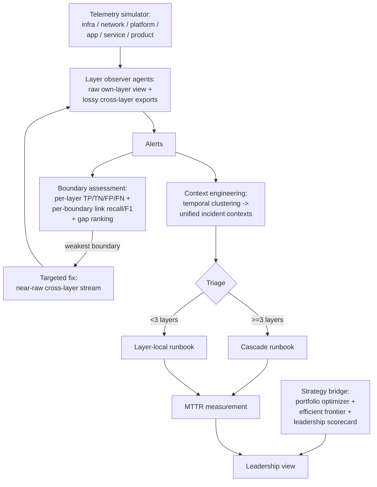

# SRE-Observability — A MAS-Based Unified Observability Platform

## Research problem

Modern enterprises run observability as a stack of layer-local tools:
infrastructure metrics, network monitors, platform telemetry, application
APM, service SLOs, product analytics. Each tool sees its own layer well,
but the *intersections* between layers -- infra-to-app, app-to-service,
service-to-product -- are blind spots where cascading failures go
unrecognized. This is the **boundary problem**: no single layer's
telemetry explains a cross-boundary incident, and siloed responders
fragment one cascade into several misdiagnosed tickets. Meanwhile,
leadership runs reliability (SRE) and strategy (product/development
investment) as separate conversations, so there is no principled way to
trade a dollar of reliability work against a dollar of innovation.

## Proposed solution

SRE-Observability is a multi-agent system that sits atop the
observability ecosystem as a plug-and-play integration layer:

* **Per-layer observer agents** with realistic capability profiles:
  strong on their own layer's raw streams, weak on every other layer's
  delayed, aggregated, noisy exports. The asymmetry *mechanistically*
  reproduces the boundary problem instead of assuming it.
* **A boundary-assessment agentic workflow** that continuously measures
  observability power per layer (TP/TN/FP/FN, precision/recall/F1,
  time-to-detect) *and* per boundary (crossing-link recall: was the
  cascade's crossing itself visible to either adjacent observer?),
  ranks boundaries by observability gap, and prescribes targeted fixes.
* **Context engineering**: cross-layer alerts are clustered into unified
  incident contexts, so one cascade becomes one incident with one
  runbook.
* **An incident-response loop** comparing siloed observers against the
  unified MAS on identical alert streams, measuring correct-runbook
  rate and end-to-end MTTR.
* **A strategy bridge**: a strategic initiative portfolio with an exact
  reliability-vs-innovation allocation optimizer, an efficient frontier,
  and a unified leadership scorecard (downtime, MTTR, incident cost,
  strategic ROI, delivery velocity).

## Architecture

**Detection** (`observers.py`): trailing median/MAD z-scores (robust to
baseline contamination from recent incidents, unlike mean/std), with a
2-of-3 consecutive-hits rule. Own-layer threshold 3.5; cross-layer views
are delayed 8 min, 15-min averaged, 1x extra noise, threshold 4.0. The
service<->product export is starved by design (40-min delay, 3x noise),
modelling the classic "infra metrics never reach the product dashboard"
blind spot.

**Boundary link** (`boundary.py`): a cascade crossing counts as observed
only if an adjacent observer raises a cross-layer alert *on one of the
crossing's own deviating metrics* inside the cascade window -- spurious
alarms on other metrics do not count.

## Experiments

`experiments/run_experiments.py` -- five seeded one-day simulations (8
intra-layer + 3 cascading incidents each):

* **(a)** per-layer vs per-boundary detection statistics;
* **(b)** weakest-boundary identification from telemetry alone;
* **(c)** closed loop: install the targeted fix, re-measure;
* **(d)** siloed vs unified MAS response on cascades;
* **(e)** Strategy frontier, recommendation, scorecard.

## Results

All numbers measured (seeds 0-4); see `results/results.md`.

**(a) The boundary problem, quantified.** Mean intra-layer segment
recall 0.91 (infra 1.00, network 1.00, platform 0.96, app 0.96, service
0.95) with time-to-detect ~1-2 min. Mean boundary crossing-link recall
0.78 -- and the links that exist lag badly: 10.8-14.2 min vs ~1.5 min
intra-layer. The service->product boundary is completely blind (recall
0.00, never linked on any seed): its export is so starved that real
deviations score z ~ 1.0-1.5 against any reasonable threshold. Note the
product layer itself only recalls 0.60 of its segments -- the cascade's
product symptom (-3 sigma) sits below the detection threshold, which is
exactly why the boundary needs cross-layer visibility rather than
louder local alarms.

**(b) Weakest boundary identified.** Ranked by observability gap
(1 - F1) from telemetry alone: service->product (1.00) >
infra->network (0.67) > app->service (0.50) > network->platform (0.43) >
platform->app (0.40). The designed blind spot is found with no access
to ground-truth design intent.

**(c) Closed loop.** Installing the targeted fix (near-raw cross-layer
stream, 2-min delay) at service->product: recall 0.00 -> 1.00, F1
0.00 -> 0.40, and the link arrives 3 min *before* downstream onset --
the boundary becomes a leading indicator.

**(d) Cascades: siloed vs unified (n=15).** Siloed observers pick the
correct runbook 73% of the time with mean MTTR 102 min; the unified
MAS is correct 100% of the time with mean MTTR 78 min. Fragmented
contexts cause wrong, layer-local runbooks (e.g. treating a cascade as
a pod issue), each costing a wasted remediation plus escalation.

**(e) Strategy bridge ($100k budget).** The efficient frontier spans
reliability-heavy (27 rel / 6 innov, $95k) to innovation-heavy (11 rel
/ 20 innov, $100k). The balanced recommendation -- boundary
observability modules + auto-remediation runbooks + checkout flow
revamp, $95k -- moves the quarterly scorecard from 320 to 80 min
downtime, 58 to 23 min MTTR, $1.40M to $0.35M incident cost, 1.00x to
2.26x strategic ROI, and 100 to 146 delivery velocity.

## Insights

* The boundary problem is better measured as *link* recall (was the
  crossing itself visible across the boundary?) than as downstream
  detection (each side usually sees its own blip). Healthy boundaries
  link; blind ones never do.
* Cross-boundary links are systematically late (8-30 min) because
  exports are delayed and aggregated -- latency, not just recall, is a
  boundary tax.
* Mean/std baselines collapse under incident crowding (a recent
  incident contaminates the trailing window); median/MAD baselines do
  not. This matters more than the detector's threshold.
* Siloed response fails on cascades not because observers are blind
  but because their contexts are partial: triage on <3 layers picks a
  layer-local runbook for a systemic problem.

## Implementation

* `src/agentic_systems/sre_observability/layers.py` -- six-layer
  telemetry simulator with intra-layer and cascading incident
  injection (all seeded).
* `src/agentic_systems/sre_observability/observers.py` -- per-layer
  observer agents; raw own-layer views vs lossy cross-layer exports;
  robust trailing median/MAD detection; export-fix overrides.
* `src/agentic_systems/sre_observability/boundary.py` -- per-layer
  TP/TN/FP/FN assessment, cascade boundary events, metric-matched
  crossing-link statistics, gap ranking.
* `src/agentic_systems/sre_observability/response.py` -- context
  engineering (temporal alert clustering), triage, runbooks, siloed vs
  unified responders with MTTR simulation.
* `src/agentic_systems/sre_observability/strategy.py` -- initiative
  portfolio, exact budget optimizer, Pareto frontier, balanced
  recommendation, leadership scorecard.
* `examples/10_sre_observability_quickstart.py` -- end-to-end demo.
