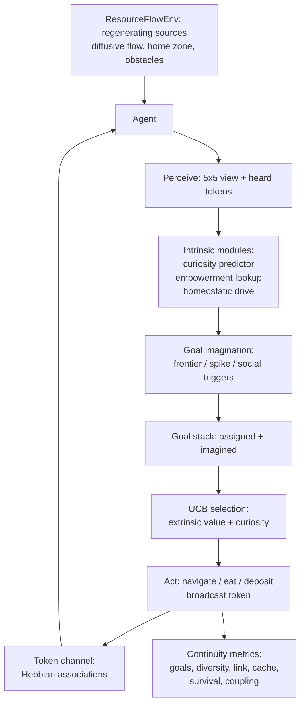
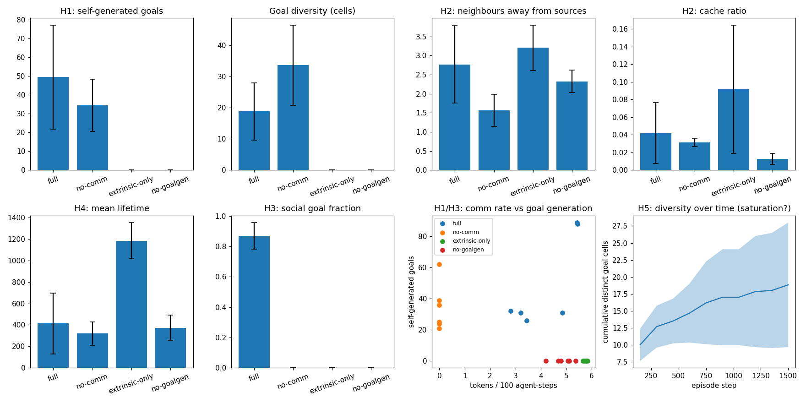

# Emergent Goals — Do Communicating Agents Invent Their Own Goals?

## Research problem

Give N agents one assigned goal and a continuous flow of resources. Will
they, by themselves, evolve *additional* goals — and keep evolving? Is
there an implicit motivation, biological or inorganic, such that when
agents communicate, an intrinsic drive toward *continuity* gets
triggered? This is the continuity hypothesis: communication catalyzes
self-generated purpose. The full research design, literature survey, and
falsifiable hypotheses are in [DESIGN.md](DESIGN.md).

## Proposed solution

A grid-world laboratory where 10 agents pursue an assigned extrinsic
goal (collect resources, deposit at home) while equipped with three
intrinsic modules and a goal-imagination mechanism:

- **Curiosity** (Schmidhuber 1991; Oudeyer et al. 2007): a tabular world
  model tracks prediction error; agents are drawn to high learning
  progress.
- **Empowerment** (Klyubin et al. 2008): a precomputed reachable-state
  proxy biases exploration toward high-option regions.
- **Homeostasis** (Friston-style, crude): an energy drive with
  metabolism, eating, and death.
- **Token communication**: 4-token broadcast with Hebbian
  token-context associations — no pre-assigned meanings.
- **Goal imagination** (IMGEP/CURIOUS-style): a visited-state archive
  seeds new goals via frontier sampling, curiosity spikes, or social
  triggers (locations heard about over the token channel).

Goals live on an explicit stack and are selected by UCB over extrinsic
value plus curiosity bonus. Four ablation conditions (full, no-comm,
extrinsic-only, no-goalgen) isolate every component's contribution.

## Architecture



## Experiments

`experiments/run_experiments.py` — 6 seeds x 4 conditions x 1500 steps
(hypotheses and metrics fixed in DESIGN.md before results were
generated). Headline numbers, means +- SD across seeds:

| Metric | full | no-comm | extrinsic-only | no-goalgen |
|---|---|---|---|---|
| Self-generated goals | 49.5 +- 27.6 | 34.5 +- 13.9 | 0 | 0 |
| Goal diversity (cells) | 18.8 +- 9.2 | 33.7 +- 12.9 | 0 | 0 |
| Neighbours away from sources | 2.77 +- 1.02 | 1.57 +- 0.42 | 3.20 +- 0.60 | 2.33 +- 0.29 |
| Cache ratio | 0.042 +- 0.035 | 0.031 +- 0.005 | 0.092 +- 0.073 | 0.013 +- 0.006 |
| Mean lifetime (steps) | 413 +- 283 | 320 +- 108 | 1185 +- 167 | 374 +- 117 |
| Deposits (assigned goal) | 30.5 +- 15.6 | 70.3 +- 6.7 | 87.7 +- 9.2 | 124.5 +- 3.3 |
| Social goal fraction | 0.87 +- 0.09 | 0 | 0 | 0 |
| Token entropy (nats) | 0.45 +- 0.06 | n/a | 0.71 +- 0.07 | 0.66 +- 0.07 |



Full table with Cohen's d: [results/results.md](results/results.md).

## Results & conclusions

1. **Communication catalyzes goal generation (H1: supported, modest).**
   Full agents imagined 49.5 goals/episode vs 34.5 without comm
   (d=+0.69). Curiosity alone does much of the work; communication adds
   a real but partial boost.
2. **Communication shapes goal *content* decisively (H3: strongly
   supported).** 87% of full agents' imagined goals targeted
   recently-heard locations. Tokens also specialized to contexts
   (0.45 nats vs 1.39 uniform) — emergent signaling without any
   pre-assigned meanings.
3. **Communication homogenizes (unexpected).** No-comm agents produced
   *more diverse* goals (33.7 vs 18.8 cells): social goal-sharing is a
   conformity pressure. A multi-agent system that talks more may
   explore less widely — a genuine tradeoff.
4. **Affiliation beyond foraging emerges (H2: partially supported).**
   Away from sources, full agents kept 2.77 neighbours vs 1.57 for
   no-comm (d=+1.55) — link maintenance not explainable by shared
   resource attraction. Caching, however, is **not supported**: the
   withheld-resource metric is confounded by pipeline inventory, and
   extrinsic-only agents scored highest.
5. **Curiosity kills — in the short run (H4: failed, reversed).** Full
   agents lived 413 steps vs 1185 for extrinsic-only (d=-3.32):
   exploration is metabolically costly, and imagined goals pull agents
   away from food. Communication helped somewhat (full 413 > no-comm
   320). The honest reading: intrinsic drives are paid for by the
   population, not the individual — exactly the biological pattern.
6. **No sustained open-endedness (H5: predicted negative confirmed).**
   Goal diversity grows but decelerates; the toy world saturates. This
   bounds the claim: drives + comm + imagination yield self-generated
   goals, not open-ended evolution.
7. **Safety-relevant: self-generated goals cannibalize the assigned
   objective.** Deposits collapsed from 124.5 (no-goalgen) to 30.5
   (full), d=-8.33. An agent that invents its own goals does not
   thereby serve its assigned one — the remit-divergence problem is
   real even in a toy, and runtime remit enforcement (cf. the
   remit-drift system) is the principled answer.

## Run it

```bash
cd 11-emergent-goals
python3 experiments/run_experiments.py   # regenerates results/results.md + charts.png
PYTHONPATH=../../src python3 ../../examples/11_emergent_goals_quickstart.py
python3 -c "import sys; sys.path.insert(0,'tests'); import test_smoke; [getattr(test_smoke,n)() or print(n,'OK') for n in dir(test_smoke) if n.startswith('test_')]"
```

Requires: Python 3.10+, `numpy`, `matplotlib`.

## Limitations

Drives are designed, not evolved — the experiment tests whether their
*interaction* plus communication suffices for self-proposed goals, not
whether drives arise from nothing (see DESIGN.md section 8 for the full
caveat list). Goals are target states, not semantic goals; tokens are
broadcast symbols, not language; the grid world is too small for
open-endedness claims; only 6 seeds per condition, so effect sizes are
indicative rather than tight.

## What I'd build next

- Evolve the drive weights themselves (meta-level open-endedness).
- Replace greedy navigation with learned policies to test whether the
  findings survive learning.
- Adversarial/mixed-motive populations: does communication still
  catalyze pro-social goals under competition?
- Wire the goal stack into the remit-drift policy engine: imagined
  goals as first-class remit-change requests requiring approval.
