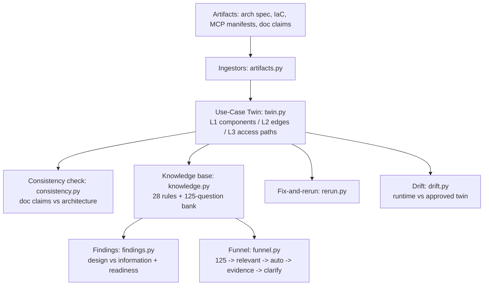
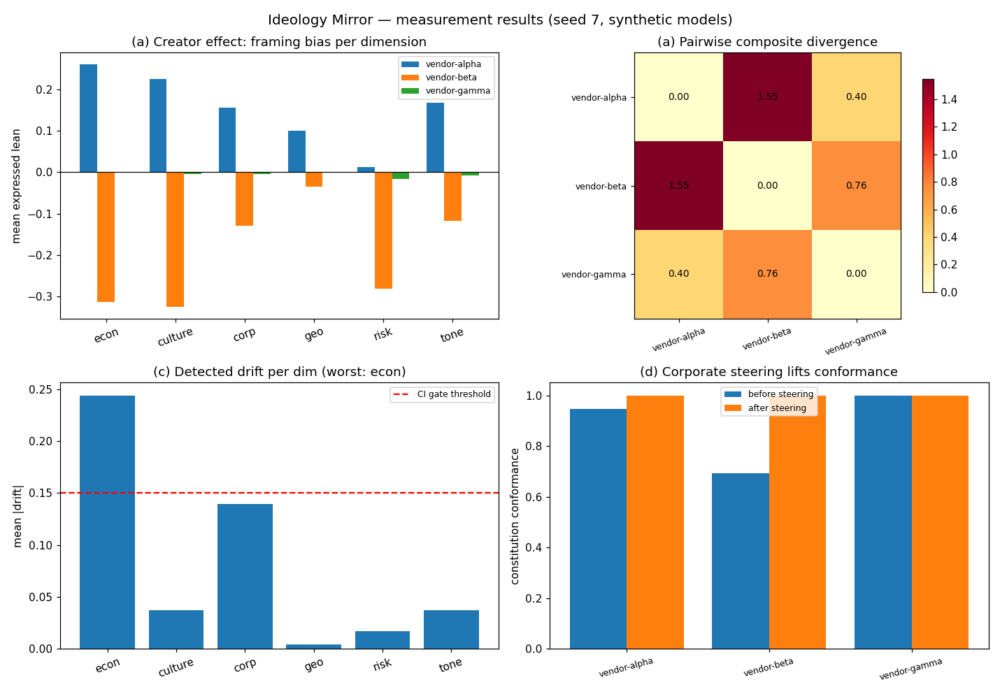

# CISO AI Risk Twin — Architecture-First AI Risk Pre-Check

## Research problem

Traditional AI risk assessment relies on static, interactive
questionnaires that place the burden of risk identification on the
developer: the developer asserts "the agent is read-only" and the
assessment trusts the assertion. Assertions are the weakest form of
evidence, yet they drive the entire verdict. Meanwhile the artifacts
that actually describe the system — architecture diagrams, IaC, MCP
tool manifests, design docs — are never analyzed.

The paradigm shift: from **answer-seeking** (forms) to
**evidence-seeking** (architectural artifacts). The driving question
becomes: *given everything we know about this proposed AI
architecture, what risks can we establish, what remains uncertain, what
evidence is missing, and what must be fixed before CISO approval?*

## Proposed solution

The CISO AI Risk Twin ingests engineering artifacts, reconstructs the
system as a canonical **AI Use-Case Twin**, and assesses it with a
knowledge-base rule engine grounded in NIST AI RMF, OWASP Top 10 for
LLM Applications, OWASP Top 10 for Agentic AI, the EU AI Act, GDPR, and
configurable internal policies. Key mechanisms:

- **Three-level parsing.** L1 components (nodes), L2 relationships
  (edges), L3 security semantics (identity/permission overlays).
- **Never trust the diagram.** A diagram edge `agent -> database` is
  resolved against IaC into the real access path (via MCP server +
  service principal). Unresolvable edges are flagged unverified, never
  assumed safe.
- **Consistency checking.** Design-doc claims are L1 assertions; the
  parsed architecture is L3. When they disagree the artifact wins.
- **Dynamic question funnel.** A 125-question bank filtered by
  architecture triggers (agent -> agentic risk, external API ->
  third-party risk, write op -> IAM/excessive agency, RAG ->
  poisoning), then auto-answered from artifacts, then evidence-required,
  then user clarification.
- **Evidence hierarchy L0-L5.** Findings grounded in user assertion
  carry high uncertainty; findings grounded in enterprise systems or
  telemetry resolve with high confidence.
- **Fix-and-rerun loop** with finding diffs, and **post-deployment
  drift detection** against the approved twin.

## Architecture



**Rule engine** (`knowledge.py`): 28 rules across OWASP Agentic AI
(excessive agency, tool poisoning, identity), OWASP LLM (prompt
injection, insecure output, sensitive disclosure, supply chain), GDPR
(PII to external LLM, data residency), EU AI Act (human oversight,
high-risk tiering, transparency), NIST AI RMF (Map/Measure/Manage/
Govern), and internal policies (TPRM, IAM least privilege, data
classification). Each rule maps a twin trigger pattern to a finding
with severity, evidence, and remedy.

**Findings** (`findings.py`): DESIGN findings (observation / concern /
required action) vs INFORMATION findings (observation / unknown /
required artifact). Readiness combines architecture completeness,
evidence completeness, control coverage, and assessment confidence
into a READY / NOT READY verdict with blocking reasons.

## Experiments

`experiments/run_experiments.py` — fully deterministic (seed 0).

**Exp A — worked example end-to-end.** Support agent claims
"read-only"; architecture shows `POST /holdTransaction`; customer PII
flows to an external LLM:

| Check | Result |
|---|---|
| Inconsistencies | 2 (read-only vs POST; no-sharing vs external LLM) |
| Findings | 29 (13 design, 16 information; 5 critical) |
| Critical titles | Excessive agency, High-stakes action w/o human, PII to external LLM |
| Readiness | 0.4104 — NOT READY (5 critical w/o control, 16 evidence items missing, 2 inconsistencies) |

**Exp B — dynamic funnel** on three architectures:

| architecture | relevant | auto-answered | evidence-required | clarification |
|---|---|---|---|---|
| simple chatbot | 65 | 3 | 40 | 22 |
| RAG assistant | 86 | 7 | 45 | 34 |
| agentic platform | 121 | 9 | 59 | 53 |

The funnel shrinks with architectural simplicity; no architecture is
asked all 125 questions.

**Exp C — evidence-level sensitivity** (same architecture, vendor pack
at increasing levels): assessment confidence 0.8082 (none) -> 0.8138
(L1) -> 0.8156 (L2) -> 0.8242 (L4); evidence completeness 0.0 -> 0.125.
Vendor evidence helps exactly where it applies — a DPA does not fix
excessive agency, and the numbers say so.

**Exp D — fix-and-rerun.** Adding a human-approval node and a tool
input schema: 7 findings resolved (AG-01, AG-02, HO-01, IAM-02,
DP-01), 2 introduced (new unclassified approval-path flows — honestly
reported), severity delta -20.

**Exp E — drift detection.** Runtime edge `support_agent ->
shadow_analytics` (PII) not in the approved twin: 1 critical alert;
all approved edges produce zero alerts.



Full table: [results/results.md](results/results.md).

## Results & conclusions

1. **Artifacts beat assertions.** The worked example's design doc
   claims "read-only" twice; the architecture shows a write. The twin
   flags both inconsistencies because L3 evidence outranks L1 claims
   by construction.
2. **The funnel is the product.** Filtering 125 questions by
   architecture triggers cuts the assessment to what matters (65 for a
   chatbot, 121 for an agentic platform) before a human is involved.
3. **Evidence hierarchy disciplines confidence.** L1 vendor assertions
   barely move confidence (+0.006); L4 enterprise evidence moves it
   (+0.016) and resolves evidence gaps. Uncertainty is quantified, not
   hand-waved.
4. **Fix-and-rerun closes the loop.** Controls evidenced in the
   architecture (human approval, input schemas) resolve findings
   measurably (severity delta -20); newly introduced flows are
   honestly reported rather than hidden.
5. **Drift makes the twin operational.** The same canonical object used
   pre-deployment becomes the post-deployment baseline — unapproved
   runtime edges alert immediately.

## Run it

```bash
cd 12-ai-risk-twin
python3 experiments/run_experiments.py   # regenerates results/results.md + charts.png
python3 tests/test_smoke.py             # 10 smoke tests
python3 ../examples/12_ai_risk_twin_quickstart.py
```

Requires: Python 3.10+, `matplotlib`.

## Limitations

Diagrams arrive as structured specs, not raw images — vision/OCR
parsing is out of scope for this simulation. The 28-rule knowledge
base is a representative subset, not a complete regulatory mapping.
The fix-and-rerun loop models control evidence structurally; real
human-approval gates need runtime integration. Drift detection
assumes trustworthy telemetry.

## What I'd build next

Vision-based diagram parsing to close the ingestion gap; a larger
rule pack mapped 1:1 to NIST AI RMF subcategories and OWASP test
cases; CI/CD gating on readiness verdict; IDE linting of MCP
manifests against the tool-poisoning rule.
