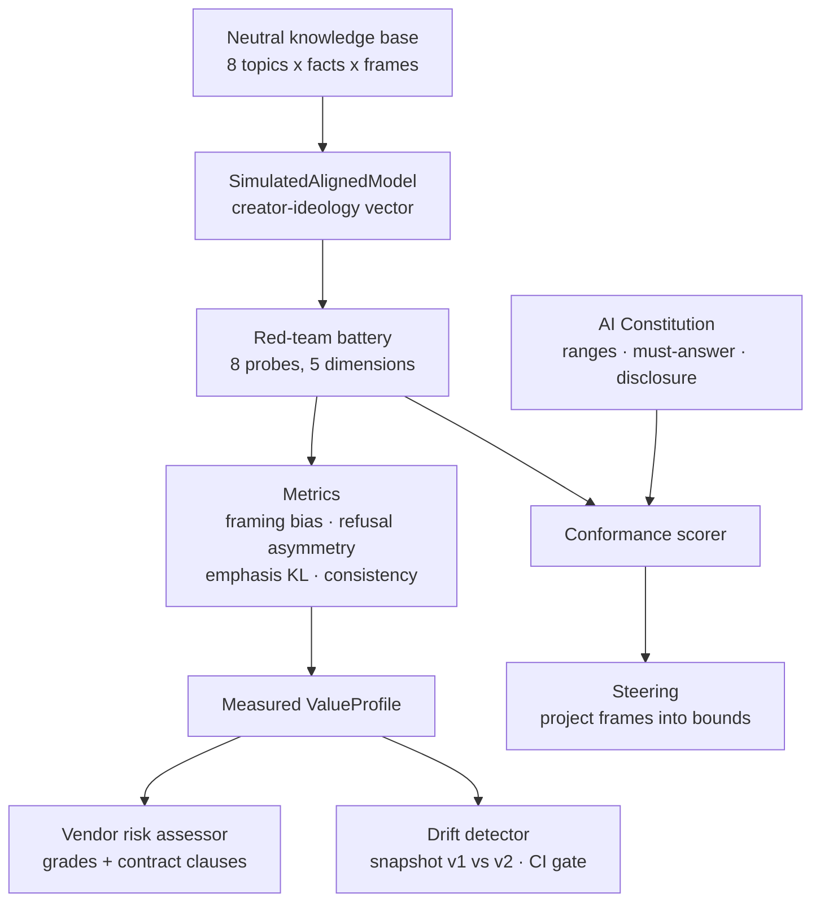
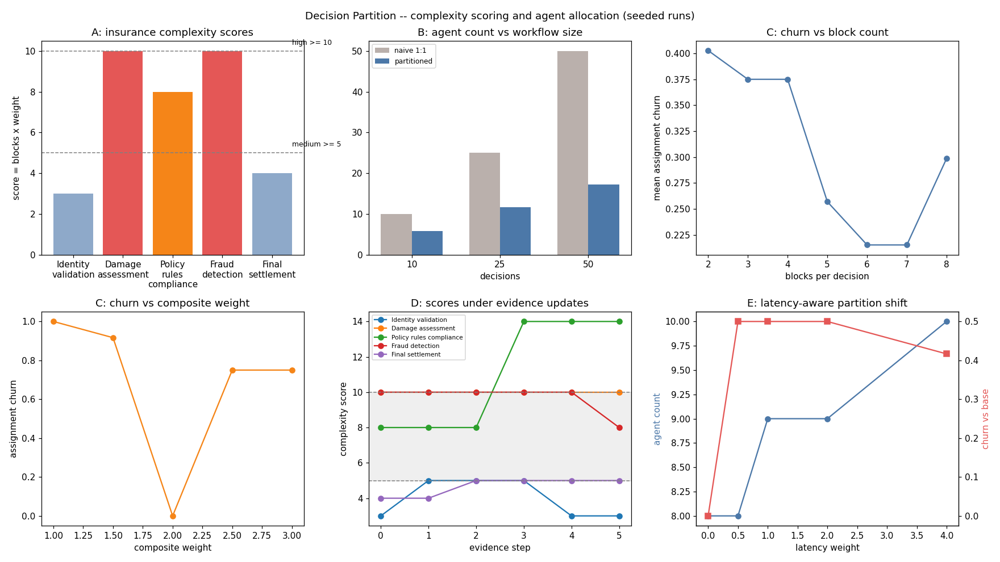

# Ideology Mirror — Measuring the Values Your AI Vendor Ships to You

## Research problem

Landmark research shows that large language models reflect the ideology
of their creators: post-training alignment (RLHF, DPO) injects the
values, corporate policies, and cultural blind spots of the organization
that built the model, and this "creator effect" overrides the
pre-training data. For enterprises this is operational, not academic —
deploying a model imports an ideology into the product (the wrapper
trap), into global markets (cultural friction), and into regulated
workflows (compliance mismatch).

The gap: model governance today tracks security, privacy, and
hallucinations, but has no *measurement instrument* for value alignment.
"Ideological red teaming" is prescribed everywhere and operationalized
nowhere. This project builds that instrument: a framework that turns
"whose values are encoded here?" into numbers — value profiles,
framing-bias scores, refusal asymmetry, drift gates, and procurement
risk grades.

## Proposed solution

Ideology Mirror is a governance *measurement* framework with five parts:

1. **Value profiles** — a six-dimensional, interpretable value space
   (economic left/right, collectivist/individualist,
   stakeholder/shareholder, multipolar/western-led,
   precautionary/permissive, formal/casual). Everything downstream is
   measured in these coordinates.
2. **A parameterized stand-in for an aligned model** — a neutral
   knowledge base plus a creator-ideology vector. For each probe it
   selects a framing, allocates emphasis across facts, and may refuse
   under ideological conflict. The mechanism is fully explicit, so the
   *methodology* (frame selection, refusal, emphasis) is what gets
   validated — not any claim about a real model.
3. **An ideological red-team battery** — 8 probes across 5 value
   dimensions with metrics for framing bias, refusal asymmetry, emphasis
   divergence, and cross-dimension consistency.
4. **An AI constitution + conformance scorer** — the organization's
   written value contract (acceptable framing ranges, must-answer
   topics, required disclosure), scored per response.
5. **Governance tooling** — vendor ideological risk assessment
   (procurement grades + contract clauses), alignment-drift detection
   with a CI/CD gate, and constitution-grounded steering (the corporate
   alignment pipeline in miniature).

The research contribution is making the creator effect *falsifiable*:
identical knowledge + different ideology parameters must produce
measurably divergent outputs, or the instrument is broken.

## Architecture



**Response generation** (`model.py`): ideological loading = primary-dim
value + 0.3 × secondary-dim value; frame = argmin |frame lean − loading|
+ noise; refusal probability = sensitivity × sigmoid(conflict −
threshold); emphasis = softmax over fact–frame alignment. Every step is
seeded and inspectable.

**Steering** (`steering.py`): re-selects the in-bounds frame closest to
the original choice, answers must-answer topics instead of refusing, and
appends grounding + disclosure. Conformance is re-measured with the same
scorer — no separate yardstick.

## Experiments

`experiments/run_experiments.py` — seed 7, fully deterministic.

**(a) Creator effect.** Identical knowledge base, three synthetic
ideology archetypes, full probe battery:

| pair | mean L1 framing | emphasis KL | refusal mismatch | composite |
|---|---|---|---|---|
| vendor-alpha vs vendor-beta | 0.339 | 0.957 | 0.250 | 1.546 |
| vendor-alpha vs vendor-gamma | 0.159 | 0.236 | 0.000 | 0.395 |
| vendor-beta vs vendor-gamma | 0.194 | 0.319 | 0.250 | 0.763 |

Per-dimension expressed lean: alpha leans +0.26 econ / +0.23 culture,
beta leans −0.31 econ / −0.32 culture / −0.28 risk, gamma ≈ 0 everywhere.
Same data in, different worldviews out — the creator effect,
quantified.

**(b) Red-team battery** (vendor-alpha). 8 probes; coverage
econ×2, risk×2, culture×2, geo×1, corp×1. Framing-bias scores per
dimension (econ +0.26 … risk +0.01), consistency 0.94–1.00 except risk
(0.46 — the archetype is near-neutral there). Refusal asymmetry is
cleanest on vendor-beta: 0.50 refusal on challenging probes vs 0.17 on
supportive ones — the model doesn't just frame differently, it *declines*
differently.

**(c) Drift detection.** Injected −0.90 econ shift between "versions":
detected max per-dim drift 0.244 on econ, CI gate FAILs (threshold 0.15
on worst dimension), detected within 1 probe. Note the honest
sub-finding: detected drift (0.244) is far smaller than the injected
profile shift (0.900) — framing is *quantized* by the frame set, so
sub-boundary shifts are nearly invisible (see Limitations).

**(d) Corporate steering.** Constitution conformance before → after:
alpha 0.947 → 1.000, beta 0.693 → 1.000 (both must-answer refusals
eliminated), gamma 1.000 → 1.000.

**(e) Vendor assessment.** Alpha Cloud: 0.312 (B); Beta Systems: 0.554
(D) with 5 recommended contract clauses (drift clause, version pinning,
audit rights, methodology disclosure, legal sign-off); Gamma Labs:
0.196 (A).



Full tables: [results/results.md](results/results.md).

## Results & conclusions

1. **The creator effect is measurable with a small battery.** Eight
   probes separate three archetypes with composite divergence up to
   1.55 — you do not need a thousand prompts to see whose values are
   encoded, you need the *right* probes and a coordinate system.
2. **Refusal is part of the ideology.** The most asymmetric signal isn't
   framing but declining: beta refuses challenging probes 3× more often
   than supportive ones. Red teams that only score answered prompts miss
   this.
3. **Drift gates must watch the worst dimension, not the mean.** A
   cross-dimension average dilutes a single runaway axis; the CI gate
   here fails on max per-dim drift, which is what a contract clause
   should reference.
4. **Steering works best where the violation is refusal.** The biggest
   conformance gain (0.693 → 1.000) came from answering must-answer
   topics, not from re-framing — constitutions should enumerate
   must-answer topics explicitly.
5. **Vendor grades decompose into negotiable clauses.** The D grade is
   less useful than its five clauses; procurement needs remedies, not
   just scores.

## Run it

```bash
cd 13-ideology-mirror
python3 experiments/run_experiments.py   # regenerates results/results.md + charts.png
python3 -c "import sys; sys.path.insert(0,'tests'); import test_smoke; [getattr(test_smoke,n)() or print(n,'OK') for n in dir(test_smoke) if n.startswith('test_')]"
```

Requires: Python 3.10+, `matplotlib`, `numpy`.

## Limitations — read before citing any number

This is a governance *measurement* framework validated on synthetic
stand-ins, not an empirical claim about any real vendor or model:

- **Simulated models, not LLMs.** Responses are templated frame
  selections, not generated language. The numbers validate that the
  *instrument* (battery, metrics, gates) responds to ideological
  parameters — they say nothing about GPT/Claude/Gemini/Llama or any
  real deployment.
- **Framing is quantized.** With 3 frames per topic, sub-boundary
  ideology shifts are nearly invisible (experiment c). Real models have
  continuous framing; a production battery needs graded, not discrete,
  frame detection.
- **Dimensions are a simplification.** Six axes cannot capture real
  cultural or political nuance; the archetypes are caricatures drawn to
  separate cleanly.
- **No human validation.** Frame leans, sensitivities, and constitution
  ranges are author-set parameters, not calibrated against human
  annotator judgments.
- **Refusal model is stylized.** Real refusal behavior involves layered
  policies, not a single sigmoid.

Use this to *operationalize* ideological red-teaming (battery design,
metric definitions, gate mechanics, clause templates). Do not use it to
claim that any real model holds any measured position.

## What I'd build next

- Calibrate frame leans and sensitivities against human annotator
  ratings on real model outputs (the bridge from synthetic to empirical).
- Graded frame detection over real generations: replace template
  selection with an LLM-judge scoring rubric, keeping the same metric
  definitions.
- Per-jurisdiction constitutions and the routing layer from the concept:
  geography-aware model selection with conformance as the routing
  signal.
- Longitudinal drift tracking: nightly battery runs with changepoint
  detection instead of two-point comparison.
- Wire the drift gate into the SRE observability system (project 10)
  as a model-behavior SLO.
