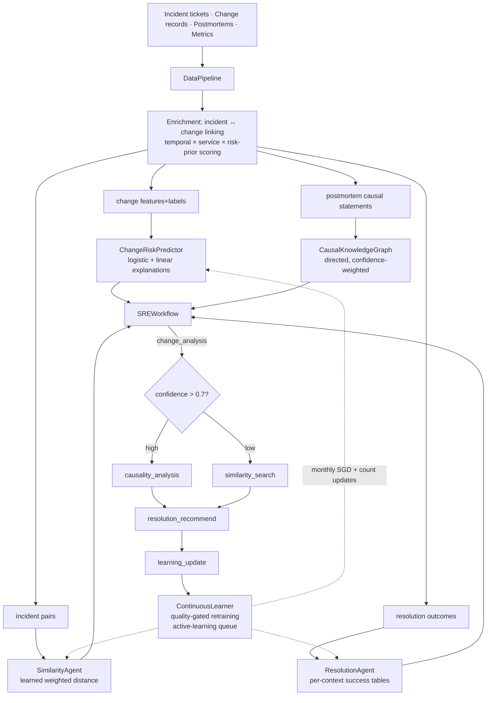
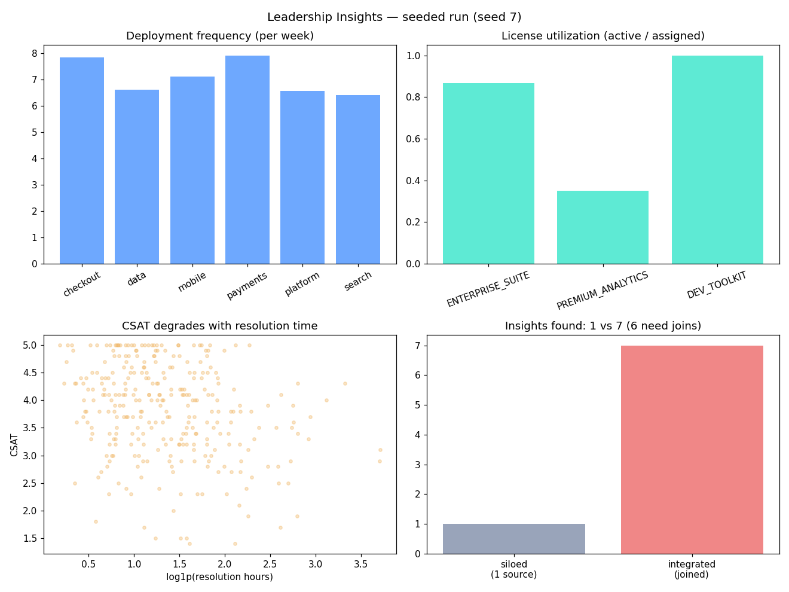

# SRE-Learning — Data-First Agentic SRE: Train on Your Incident History

## Research problem

SRE agents are usually built on theoretical models of failure: hand-written
runbooks, generic anomaly detectors, and correlation rules that know nothing
about *your* systems. Meanwhile every organization sits on the richest
possible training signal — its own incident tickets, change records,
postmortems, metrics, and alert history — and uses it only for forensics,
never for prevention.

The data-first hypothesis: **past incidents are the training data for
future prevention.** Four questions follow: can we learn change risk from
change features, can we link incidents to their causal changes, can we
learn what "similar incident" means to an SRE team, and can we recommend
resolutions from historical outcomes — all from the same historical
corpus, and keep learning as new incidents arrive?

## Proposed solution

SRE-Learning is a data pipeline plus four trained agents plus a
coordination workflow plus a continuous-learning loop, all in numpy:

* **DataPipeline** — extract incidents/changes, then *enrich*: link each
  incident to candidate changes in the 24h pre-incident window via
  temporal-decay × service/topology × change-risk-prior scoring, and emit
  per-agent training datasets.
* **ChangeRiskPredictor** — L2 logistic regression on 7 change features
  (type, criticality, blast radius, deploy hour, author experience,
  complexity, test coverage) with exact linear log-odds explanations
  ("High risk (0.85) — primarily due to blast radius (60%)").
* **CausalKnowledgeGraph** — parses causal statements from postmortems
  into a directed graph with saturating edge confidence; predicts
  root-cause paths (multi-hop product of confidences) and can fold in
  change-type context from the linking step.
* **SimilarityAgent** — learns a weighted incident distance from labeled
  pairs (a lightweight, interpretable analogue of Siamese contrastive
  learning) with an active-learning queue for uncertain pairs.
* **ResolutionAgent** — per-context (root cause × tier) action success
  tables with smoothing, plus *counterfactual reweighting*: failed
  recommendations credit the runner-up from similar contexts.
* **SREWorkflow** — LangGraph-style conditional state machine:
  change_analysis → high confidence ⇒ causality_analysis,
  low confidence ⇒ similarity_search → resolution_recommend →
  learning_update.
* **ContinuousLearner** — monthly ground-truth collection, quality-gated
  incremental retraining (SGD partial fits, count updates), active-learning
  flags, learning-velocity metrics, and retrain triggers.

## Architecture



## Experiments

`experiments/run_experiments.py` — seeded world (seed 7): 2400 changes,
792 incidents over 180 days; days 0–120 train, days 120–180 test.

| # | Experiment | Result |
|---|---|---|
| A | Change-risk: AUC / precision / recall on held-out changes | **0.761** (Bayes ceiling 0.761); P 0.69 / R 0.22 |
| B | Incident→change linking: top-1 / top-3 vs recency baseline | **0.73 / 0.92** vs recency 0.74 top-1 |
| C | Causal paths: graph vs correlation-only baseline | graph top-3 **0.99**, correlation top-3 1.00 |
| D | Similarity: precision@k, learned vs TF-IDF | P@1 **1.00** vs 0.90; P@5 1.00 vs 0.92 |
| E | Resolution: simulated success vs most-frequent baseline | **0.89** vs 0.41 |
| F | Continuous learning under concept drift (6 months) | frozen 0.58 → continuous **0.67** (+0.030 AUC/month) |
| G | Active learning: labeling budget vs pair accuracy | 100 uncertainty labels beat 200 random labels |

**B — linking.** Top-1 is genuinely hard (0.73, tied with naive recency
at 0.74 — recency is a strong prior when onsets cluster after deploys).
The enrichment's value is the *candidate set with evidence*: top-3
reaches 0.92, which is the operational metric when an analyst reviews
candidates.

**C — causality.** The correlation baseline is strong on top-1 (0.944)
because symptom→cause co-occurrence is highly informative in this world.
The graph matches it on top-3 (0.99 vs 1.00) and wins top-1 (0.958) when
the linked change type is correct — i.e., the graph's change-context
helps exactly when the pipeline's linking step is right, and noisy links
hurt (0.85). Pipeline order matters.

**F — continuous learning.** With concept drift injected at day 90 (night
deploys get safer, blast radius matters more), the frozen month-1 model
sits at 0.58 AUC on post-drift validation while monthly SGD updates climb
to 0.67 (+0.030/month). Human-intervention rate falls 0.40 → 0.33 as the
model adapts.

**G — active learning.** In the low-data regime (200 labeled pairs, hard
negatives), uncertainty sampling reaches with 100 labels (0.971) what
random sampling cannot reach with 200 (0.966) — roughly 2x labeling
efficiency, though absolute gains are small because pair classification
saturates quickly.



Full table: [results/results.md](results/results.md).

## Results & conclusions

1. **History beats theory.** A change-risk model trained on 4 months of
   synthetic history recovers the ground-truth weights (MAE 0.14) and hits
   the Bayes AUC ceiling (0.761) — the limit is label noise, not model
   capacity.
2. **Linking is the bottleneck.** Change→incident attribution is the
   hardest step (top-1 0.73); invest in the candidate set and evidence,
   not in pretending top-1 is reliable.
3. **Structure helps conditionally.** Causal graphs beat raw correlation
   only when fed correct upstream context — a finding *for* pipeline
   design (link first, then reason), not against graphs.
4. **Learned similarity beats text search.** A learned weighted distance
   over onset-observable features (P@1 1.00) beats TF-IDF over
   postmortems (0.90) — because at incident onset there is no postmortem
   yet.
5. **History recommends better actions.** Per-context success tables
   (0.89 simulated success) more than double the most-frequent-action
   baseline (0.41).
6. **Learning velocity is measurable.** Under drift, monthly incremental
   updates recover +0.030 AUC/month while the frozen model flatlines —
   the "secret sauce" is a metric, not a slogan.
7. **Shadow mode graduates on evidence.** The workflow's confidence
   gating (0.7 threshold) plus the learner's intervention-rate tracking
   give a principled path from shadow mode to autonomy.

## Run it

```bash
cd 14-sre-learning
python3 experiments/run_experiments.py   # regenerates results/results.md + charts.png
python3 -c "import sys; sys.path.insert(0,'tests'); import test_smoke; [getattr(test_smoke,n)() or print(n,'OK') for n in dir(test_smoke) if n.startswith('test_')]"
PYTHONPATH=../src python3 ../examples/14_sre_learning_quickstart.py
```

Requires: Python 3.10+, `matplotlib`, `numpy`, `scipy`.

## Limitations

All data is synthetic: the "historical truth" is a known logistic model,
so results measure *learning-protocol* behavior, not production SRE
performance. Postmortem causal parsing is deterministic template matching
— a production system would need an LLM extractor (the graph and scoring
are parser-agnostic). The TF-IDF baseline is deliberately denied
postmortem text on queries (realistic: no postmortem exists at onset).
Resolution "success" is simulated from ground-truth rates, not observed
in a live environment. Concept drift is a single discrete shift; real
drift is gradual and multi-dimensional.

## What I'd build next

- Gradual/multi-dimensional drift with drift *detection* (not just adaptation).
- Learned link scorer (replace hand-tuned temporal×service×prior weights).
- Embedding-based similarity (sentence embeddings over postmortems) vs the learned metric.
- A ServiceNow-shaped webhook adapter demonstrating the non-disruptive integration pattern.
- Cross-service transfer: train on one service topology, evaluate on another.
```

Now the quickstart and smoke tests.