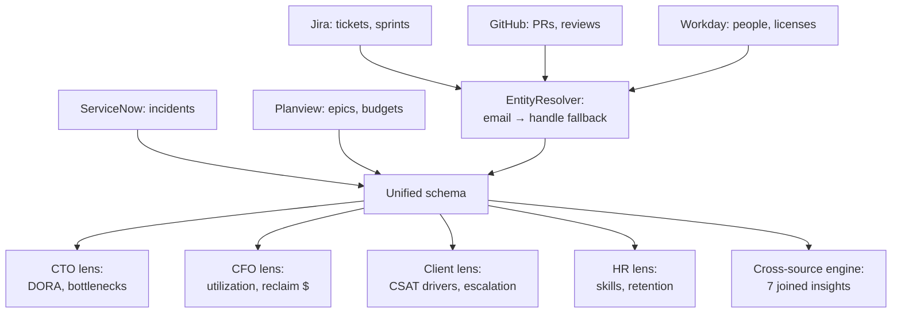

# Leadership Insights — Decisions That Only Exist When Sources Join

## Research problem

Jira knows cycle time. ServiceNow knows incidents. GitHub knows review
latency. Workday knows licenses and satisfaction. Planview knows budgets.
Each system answers its own questions — but the questions leadership
actually asks live *between* the systems: which team is the delivery
bottleneck, where is license money being burned, which client-facing
service is about to escalate, who is about to quit. Siloed analytics
cannot answer them, because the evidence is scattered across five
different identity schemes and schemas.

## Proposed solution

A four-layer pipeline:

1. **Synthetic enterprise** (`generators.py`): 60 people, 6 teams,
   1,051 Jira tickets, 1,105 GitHub PRs, 563 ServiceNow incidents,
   24 Planview epics over 180 seeded days — with four *injected* problems
   recorded as ground truth (bottleneck team, license waste,
   retention-risk group, escalation cluster).
2. **Integration layer** (`integrate.py`): entity resolution across
   identity schemes (Jira handle / GitHub handle / Workday email), then
   one unified schema with canonical `person_id`s.
3. **Four leadership lenses** (`cto.py`, `cfo.py`, `client.py`, `hr.py`):
   DORA metrics + bottleneck detection; license utilization + dollar
   reclaim lists; resolution timelines + CSAT drivers + an escalation
   predictor; productivity/satisfaction + skill gaps + retention-risk
   scoring.
4. **Cross-source insight engine** (`cross.py`): seven insights that join
   sources — each declaring the sources it needs, so a siloed-vs-integrated
   ablation measures exactly what single-source analytics misses.

## Architecture



**Entity resolution** (`integrate.py`): exact email match first, then
normalized handle matching (dots/digits/suffixes stripped). The generator
plants a same-name collision ("Alex Kim" × 2, distinct emails/handles) and
three rows with missing emails to force the fallback path.

## Experiments

`experiments/run_experiments.py` — seed 7, fully deterministic:

- **(a) Metric accuracy**: estimated review latency / escalation rates vs
  the generator's injected parameters.
- **(b) Injected-issue recovery**: does each lens find its planted problem
  (precision/recall)?
- **(c) Dollar quantification**: reclaimed license savings vs planted waste.
- **(d) Siloed vs integrated**: insights found with one source vs joined.
- **(e) Entity resolution**: precision/recall/F1 vs canonical identities.
- **(f) Escalation predictor**: train-400/test-160, threshold at train base
  rate.

Outputs: `results/results.md` + `results/charts.png`.

## Results & conclusions

1. **Entity resolution is the unlock — and it is solvable.** Email-path
   linking scores precision/recall/F1 = **1.00** over 2,153 rows; the 3
   email-less rows all resolve via handle fallback (3/3), including
   disambiguating the two Alex Kims by email rather than name.
2. **Every planted problem is recovered.** Bottleneck lens flags
   `platform` alone (p95 review **114h** vs org ~22h, 6.6 deploys/wk) with
   zero false positives. License lens recovers all 20 planted idle seats
   (precision/recall **1.0**) and prices them at **$35,040/yr** — exactly
   the planted 12×$180 + 8×$95 monthly waste. Retention top-10 catches all
   5 true attrition risks (recall **1.0**). Escalation lens identifies
   `checkout-web` (29.7% vs 12.4% org-wide).
3. **Metric estimates track ground truth.** Estimated review-latency means
   land within 15–30% of injected values; the systematic overestimate is
   understood, not noise — the generator's parameter is the log-median
   while the lens measures the arithmetic mean of a lognormal
   (factor ≈ 1.20).
4. **Six of seven insights need joins.** Siloed mode finds 1 insight
   (license waste, Workday-only); integrated mode finds 7. The missed six —
   review-latency vs change failure, speed/stability tradeoff, activity-
   confirmed reclaim, escalation×staffing, retention dollars,
   satisfaction/throughput — are unreachable without joining sources.
5. **The engine tests hypotheses; it does not confirm them.** The
   review-latency → change-failure insight measured lift **−23%** (slow
   reviewers fail *less* here), so the engine reports "no link found"
   instead of asserting the expected story — checkout's high incident base
   rate dominates. A negative result is still a decision input.
6. **Rare-event prediction is honest about its limits.** The escalation
   predictor (severity + repeat-offender + service history, numpy logistic
   regression) reaches F1 **0.20** / recall **0.27** at the base-rate
   operating point — modest, but above the ~0.12 of chance, and useful as
   an early-warning triage signal rather than an oracle.

## Run it

```bash
cd 15-leadership-insights
python3 experiments/run_experiments.py   # regenerates results/results.md + charts.png
python3 -c "import sys; sys.path.insert(0,'tests'); sys.path.insert(0,'../src'); import test_smoke; [getattr(test_smoke,n)() or print(n,'OK') for n in dir(test_smoke) if n.startswith('test_')]"
PYTHONPATH=../src python3 ../examples/15_leadership_insights_quickstart.py
```

Requires: Python 3.10+, `numpy`, `pandas`, `matplotlib`.

## Limitations

The enterprise is synthetic: identity schemes are cleaner than real
dirt (no typos, no contractors, no M&A renames), incident/ticket volumes
are modest, and the four injected problems are separable by construction.
The escalation predictor's features are weak by design (rare events are
hard); a production version would add alert text, deploy correlation, and
on-call load. License "last used" is taken at face value — the
activity-confirmed insight exists precisely because that field lies in
real life.

## What I'd build next

- NLP over ticket/incident text (TF-IDF topic drift as a leading indicator).
- A live connector shim (Jira/ServiceNow/GitHub/Workday REST) replacing the
  generator, keeping the lenses unchanged.
- Causal (not correlational) cross-source rules with the semantic fabric's
  L5 causal layer (project 8).
- Counterfactual CFO mode: "reclaim these seats, what breaks?" via the
  activity graph.
