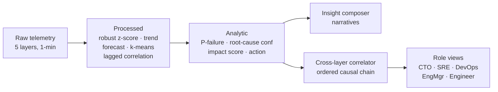

# Enriched Observability — Raw Telemetry to Decision-Grade Intelligence

## Problem

Global enterprises run 5+ clouds, hundreds of data centers, thousands of
applications. Each observability layer (infrastructure, platform,
application, SRE, business) emits raw telemetry in its own dialect, and
engineers manually stitch it together during incidents. The cost is
measured in coordination overhead and downtime: raw data is abundant,
but decision-grade intelligence is scarce. Existing multi-agent SRE
platforms (including system 10 in this repo) detect and respond — but
they do not systematically *enrich*: the three-stage journey from a raw
log line to "migrate workloads to AZ2, $1.7M/hour at risk" is left
implicit.

## Current gap

Classical anomaly detectors flag points, not stories. Dashboards show
metrics, not meaning. What is missing is a per-layer enrichment pipeline
with a defined contract at each stage — raw (what happened), processed
(what it means statistically), analytic (what to do about it) — plus a
cross-layer correlation engine that assembles one causal chain, and
role-specific views so the CTO, the SRE director, and the on-call
engineer each receive the slice they can act on.

## Solution

A five-layer enrichment pipeline. Every layer runs the same three
stages:

1. **Raw**: minute-granularity telemetry (CPU, latency, pod events, API
   traces, SLO metrics, revenue signals).
2. **Processed** (classical AI): robust median/MAD anomaly scoring,
   least-squares trend, linear-regime breach forecasting, numpy k-means
   event clustering, lagged cross-correlation.
3. **Analytic**: failure probability, root-cause confidence, business
   impact score, and a rule-based recommended action.

A template-based insight composer renders human-readable narratives
from analytic records; a cross-layer correlation engine links layer
events into one ordered causal chain (temporal order + correlation
strength); five role views (CTO, SRE director, DevOps lead, engineering
manager, individual engineer) filter the chain to decision-relevant
facts.

## Architecture



Module map (`src/agentic_systems/enriched_observability/`):

- `telemetry.py` — seeded generators per layer; injected CDN-TLS
  cascade (infra -> platform -> application -> sre -> business) plus
  independent incidents; ground-truth anomaly intervals.
- `enrich.py` — robust_z, trend_slope, forecast_breach,
  kmeans_1d, lagged_corr, detect_intervals, naive baselines.
- `analytic.py` — failure_probability, root_cause_confidence,
  impact_score, rule-based recommend().
- `composer.py` — deterministic narrative templates.
- `correlate.py` — chain reconstruction, link recall / onset MAE.
- `roles.py` — five role views + relevance rubric.

## Results

Seeded runs (seeds 7, 11, 42, 0, 99). Full tables in `results/`.

**Cascade end-to-end.** Detection delay vs true onset: infra 0.8 min,
platform 17.0, application 3.0, sre 4.6, business 1.6. Chain link
recall 1.00, onset MAE 5.5 min, zero spurious links. Pipeline wall
time 0.27 s for 8 h of telemetry.

**Anomaly detection (per-minute P/R, robust vs naive fixed threshold).**

| layer | robust P | robust R | naive P | naive R |
|---|---|---|---|---|
| infra | 0.963 | 0.909 | 0.679 | 0.345 |
| platform | 0.579 | 0.413 | 0.704 | 0.545 |
| application | 0.917 | 0.908 | 0.105 | 0.448 |
| sre | 0.801 | 0.914 | 0.000 | 0.000 |
| business | 0.725 | 0.368 | 0.447 | 0.976 |

Neither detector dominates: the robust z-score wins on precision and
on gradual onsets the fixed threshold never fires on (sre); the naive
threshold wins on recall for sustained exceedances when the threshold
happens to be right (business). Threshold choice is the naive
detector's hidden parameter — the robust detector has none.

**Forecasting.** Time-to-breach predicted at onset+10 min: MAE 3.4 min
(n=16 forecasts).

**Role views.** Relevance rubric (0..1): enriched views score 1.00 for
all five roles vs 0.80-0.90 for the raw-dump baseline (everything for
everyone, penalized for noise).

**Triage proxy.** 18.2 raw alerts collapse to a 5-item enriched chain.

## Insights

- Detection latency is dominated by ramp steepness, not detector
  quality: the sharp infra onset is caught in under a minute, the
  40-minute platform ramp takes 17.
- Slow-burn signals evade adaptive detectors: the trailing median
  chases a gradual ramp, so sustained small deviations need either a
  lagged baseline or a fixed threshold — there is no free lunch.
- Step-like cascades make lagged-correlation direction ambiguous;
  temporal onset order plus correlation strength is the robust link
  criterion.
- Forecasting is only meaningful mid-ramp: at the exact detection
  minute the regime window is too short; at interval end the threshold
  is already crossed. Onset+10 is the honest operating point.
- Role relevance is mostly about subtraction: the raw dump contains
  every required fact, but the noise penalty is what the enriched view
  removes.

## Honest limitations

The insight composer is deterministic templates, not an LLM: it stands
in for GenAI log summarization, and the measured contribution is the
enrichment pipeline, not prose quality. Telemetry is synthetic with
known ground truth — real telemetry has messier noise, missing data,
and clock skew the correlator does not model. The "business" layer is a
thin revenue/CSAT proxy, not a real BI integration.

## Implementation

```
src/agentic_systems/enriched_observability/
  telemetry.py   # generators + cascade + ground truth
  enrich.py      # processed stage: z-score, trend, forecast, k-means, xcorr
  analytic.py    # analytic stage: probabilities, impact, recommendations
  composer.py    # narrative templates (LLM stand-in, deterministic)
  correlate.py   # cross-layer chain reconstruction + scoring
  roles.py       # five role views + relevance rubric
16-enriched-observability/
  experiments/run_experiments.py   # 6 experiments, seeded
  results/            # results.md + charts.png (generated)
  tests/test_smoke.py # 10 smoke tests
```

Run: `cd 16-enriched-observability && python3 experiments/run_experiments.py`
