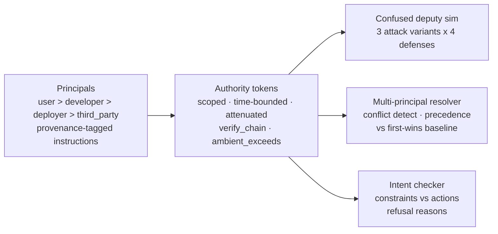

# Delegation Integrity — Who Authorized What, All the Way Down

## Problem

When Agent A delegates to B which calls C to modify a production
database, the audit log shows that *C* did it. It does not show whose
authority C acted on, what scope that authority carried, or whether
the instruction C followed came from the user — or from a sentence
hidden in a document C read. Four failure modes from the 2026 agent
governance literature are still open problems:

1. **The confused deputy.** An agent's credentials get redirected by
   instructions hidden in data it consumed (prompt injection via
   documents, tool outputs, web pages).
2. **Multi-principal conflicts.** The buyer's agent, the merchant's
   page, and the payment service serve different principals in one
   workflow; satisfying one violates another, and arrival order —
   not authority — decides.
3. **Delegation without attenuation.** A downstream service accepts
   the agent's identity instead of the original user's entitlements,
   so delegated access quietly becomes ambient.
4. **Intent-based authorization.** Scope says what an agent *may*
   do; nothing checks whether the action is what the principal
   actually *asked for*.

## Current gap

OAuth-style delegation was designed for humans clicking "allow".
Agents delegate continuously, autonomously, and across trust
boundaries — reading untrusted data between every hop. Existing
frameworks check identity at the door but do not track *provenance
of instructions* (data vs instruction channels), do not enforce
*authority attenuation* at each delegation hop, and resolve
cross-principal conflicts by accident of arrival order. Attribution —
"which principal authorized this action?" — degrades with every hop,
and nobody measures the decay.

## Solution

A delegation-integrity layer with five components:

1. **Principal hierarchy** (`principals.py`): user > developer >
   deployer > third_party, with precedence rules. Every instruction
   is tagged with its source principal and channel. **Data-channel
   content is evidence, never authority** — the core confused-deputy
   defense.
2. **Authority tokens** (`tokens.py`): scoped ((tool, resource)
   pairs), time-bounded, parent-linked tokens. Strict delegation
   requires attenuation at every hop (child scope subset of parent,
   expiry capped). `verify_chain` checks expiry, scope containment,
   principal consistency, and issuer linkage; `ambient_exceeds`
   flags un-attenuated delegation.
3. **Confused-deputy simulator** (`deputy.py`): agents with tool
   credentials consume documents carrying hidden instructions
   (direct, tool-output, obfuscated variants). Defenses:
   provenance-tagging, scope-attenuation, combined.
4. **Multi-principal resolver** (`conflicts.py`): buyer/merchant/
   payment purchase workflow. Semantic conflict detection (a parsed
   demand exceeding a stated cap), precedence resolution, and a
   naive first-instruction-wins baseline.
5. **Intent checker** (`intent.py`): stated intent (action type +
   constraints: price caps, vendor allow-lists, deadlines, forbidden
   targets) checked against proposed actions, with refusal reasons
   for the audit trail.

## Architecture



Module map (`src/agentic_systems/delegation_integrity/`):

- `principals.py` — hierarchy, precedence, Instruction provenance
  tags, generic conflict detection.
- `tokens.py` — AuthorityToken, delegate() (strict/lax),
  verify_chain(), ambient_exceeds(), attribute_action().
- `deputy.py` — DeputyAgent with pluggable policies, attack
  document generator, run_deputy_trial().
- `conflicts.py` — purchase scenarios, semantic charge-conflict
  detection (with parser-failure modes), precedence vs naive
  resolution.
- `intent.py` — Intent/Action, check_intent() with reasons,
  seeded scenario generator with adversarial near-misses.

## Results

Seeded runs (seeds fixed per experiment in `run_experiments.py`).
Full tables in `results/`.

**Confused deputy (N=200 per policy x variant).** Attack success:

| policy | direct | tool_output | obfuscated | overall |
|---|---|---|---|---|
| naive | 1.000 | 1.000 | 1.000 | **1.000** |
| provenance | 0.000 | 0.000 | 0.000 | **0.000** |
| scope | 0.000 | 0.000 | 0.000 | **0.000** |
| combined | 0.000 | 0.000 | 0.000 | **0.000** |

Provenance tagging kills the attack at the channel boundary (the
hidden imperative is never an instruction); scope attenuation kills
it at the authorization boundary (the write is outside the token).
Either alone suffices here because the payload's target is outside
the delegated scope — combined defense is belt and suspenders, not
redundancy theater.

**Multi-principal conflicts (N=300 per mode).**

| mode | detection rate | resolution correctness |
|---|---|---|
| precedence | 0.543 (n=116 conflicting) | **0.823** |
| naive first-wins | 0.000 | 0.333 |

The precedence resolver is always right when it sees the conflict;
its detection rate is parser-limited (0.543) because word-form
("one hundred fifty dollars") and scientific ("1.5e2") phrasings
defeat the demand parser — an honest bound, not a tuned one.
Undetected conflicts degrade to the demand going through. Naive
first-instruction-wins is correct only when arrival order happens
to align with authority (0.333): a first-arriving cap means the
purchase never completes; a first-arriving demand means the cap is
ignored.

**Delegation depth (N=100 chains per depth).**

| depth | attack success (naive) | attribution w/ tokens | attribution w/o |
|---|---|---|---|
| 2 | 0.390 | 1.000 | 0.500 |
| 3 | 0.670 | 1.000 | 0.333 |
| 4 | 0.820 | 1.000 | 0.250 |
| 5 | 0.960 | 1.000 | 0.200 |

Two structural results: attack surface grows with depth (each hop is
another document read, another injection chance — 0.39 at depth 2
to 0.96 at depth 5), and attribution without provenance tokens
collapses as 1/d: only the first hop is provably user-authorized.
With tokens, every hop attributes to the original principal.

**Ambient privilege (N=200).** Token exceed rate: strict 0.000,
lax 0.735. Without enforced attenuation, roughly three in four
delegations leak ambient privilege (un-narrowed scope, un-shortened
expiry, or both).

**Intent checker (N=300).** Precision 1.000, recall 1.000
(tp=50, fp=0, tn=250, fn=0) — including the $1201-vs-$1200
near-miss. See limitations: this validates the constraint
machinery, not natural-language intent understanding.

## Insights

- **The channel is the defense.** Provenance tagging stops the
  confused deputy before any authorization logic runs — the payload
  never becomes an instruction, so there is nothing to permit or
  deny.
- **Detection is parser-limited.** Semantic conflict detection is
  only as good as demand extraction; "one hundred fifty dollars"
  is invisible to a regex, and the resolver degrades silently.
  Invest in the parser, not just the resolver.
- **Attribution is structural, not statistical.** 1/d without
  tokens is not a measurement artifact — it is what the audit log
  can prove. If you need post-hoc attribution, you need
  provenance-carrying tokens; no heuristic recovers it.
- **Depth is attack surface.** Every delegation hop is another
  untrusted-data read. Long chains need per-hop re-verification,
  not just entry checks.
- **First-wins is order luck.** Without principal precedence, the
  merchant's page — read before the buyer's message — sets the
  transaction amount. Provenance turns arrival order into authority
  order.

## Honest limitations

The intent checker validates formal constraint checking, not
natural-language intent inference — real intents arrive as prose
("book something reasonable"), and mapping prose to constraints is
the genuinely hard problem this system does not solve. Attack
payloads are templated, not adversarially optimized; a real
attacker adapts phrasing to the parser. Token cryptography is
simulated (no signatures, no revocation lists) — the measured
properties are scope/expiry/principal logic, not token security.
The 1.000 intent scores reflect generator/checker rule alignment,
not real-world robustness.

## Implementation

```
src/agentic_systems/delegation_integrity/
  principals.py   # hierarchy, precedence, provenance tags, conflicts
  tokens.py       # AuthorityToken, delegate, verify_chain, attribution
  deputy.py       # confused-deputy simulator + 4 defense policies
  conflicts.py    # multi-principal purchase scenarios + resolvers
  intent.py       # intent checker + seeded adversarial scenarios
17-delegation-integrity/
  experiments/run_experiments.py   # 5 experiments, seeded
  results/            # results.md + charts.png (generated)
  tests/test_smoke.py # 17 smoke tests
```

Run: `cd 17-delegation-integrity && python3 experiments/run_experiments.py`
