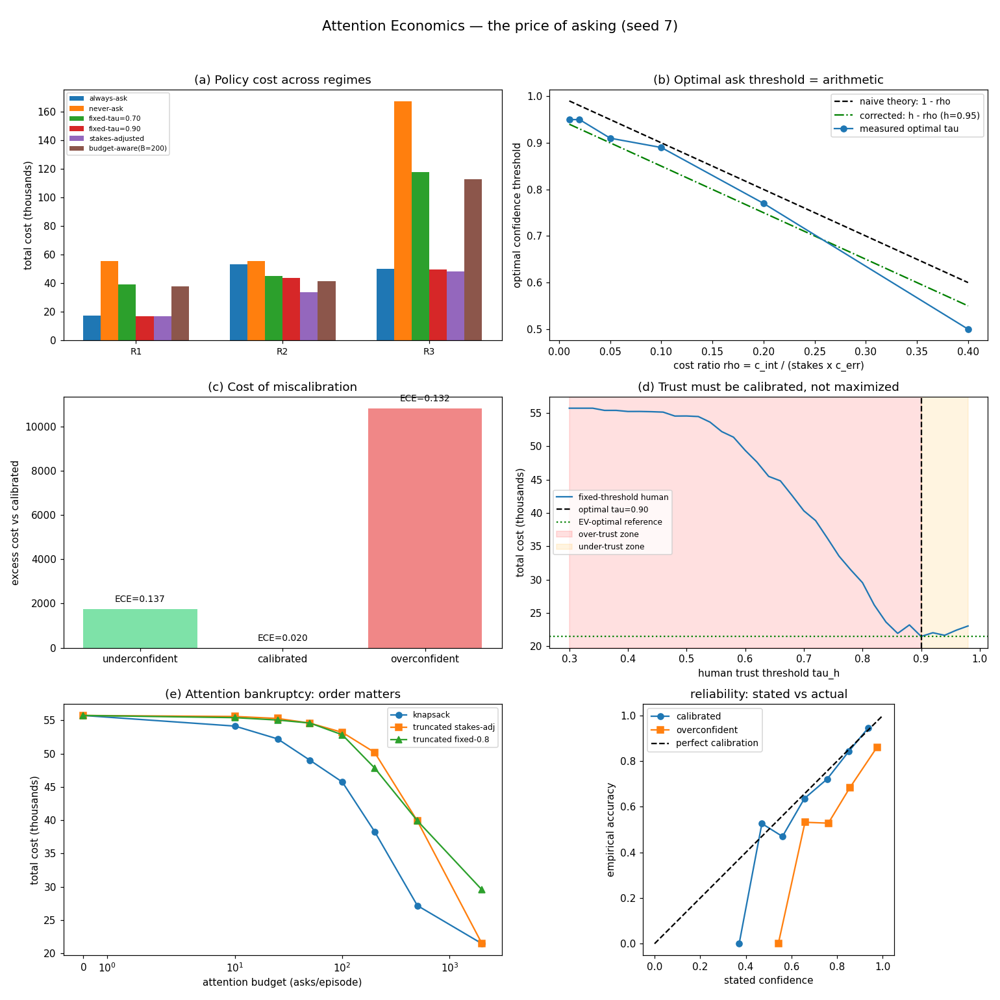

# Attention Economics — Pricing the Human in the Loop

## Research problem

Every deployed agent faces the same unanswered question: *when should it
interrupt the human?* Current systems pick one of two failure modes.
Interrupt constantly and the human's attention collapses under
context-switching fatigue -- the principal stops reading the alerts and
the oversight becomes theater. Act autonomously on everything and
high-stakes errors slip through unaudited -- the accountability failure.
There is no principled middle: nobody prices the interruption against the
error, nobody sets the ask-vs-act threshold from the cost ratio, and
nobody measures whether the human's trust matches the agent's actual
reliability. Over-trust and under-trust are both expensive, and both are
invisible in today's evaluations.

## Proposed solution

Attention Economics treats human attention as a scarce, priced resource
and derives the escalation policy from first principles. Each decision
carries stakes and the agent's stated confidence; the human principal has
an interruption price, an error price, a fallible judgment (95% accurate
here), and a hard attention budget. The expected value of asking is

    V(ask) = (h - c) * stakes * error_cost - interruption_cost

where `h` is the human's accuracy and `c` the agent's stated confidence.
The stakes-adjusted policy asks exactly when V(ask) > 0 -- the
per-decision optimal rule. Under a hard budget, the budget-aware policy
runs the knapsack: unit-cost interruptions, so highest-value-first is
optimal. The framework separately measures the agent's confidence
calibration (ECE, reliability diagrams) and the human's trust calibration
(over-trust / under-trust indices against the EV-optimal reference),
because miscalibrated confidence is what *causes* miscalibrated trust.

## Architecture

```
decision stream ──► stakes s_i, stated confidence c_i, ground truth
                        │
        ┌───────────────┼───────────────────┐
        │               │                   │
   always-ask      fixed threshold      stakes-adjusted       budget-aware
   never-ask       ask iff c < tau      ask iff (h-c)*s*e>i   knapsack: top-B
                        │                   │                by value, value>0
                        └───────────────┼───────────────────┘
                                        ▼
                    human principal: budget, interruption cost,
                    error cost, 95% accuracy when asked
                                        ▼
                    cost = asks x c_int + unaudited errors x stakes x c_err
```

**World** (`world.py`): seeded decision streams with lognormal stakes and
a Beta-skewed competence profile (accuracy ~0.80). `miscalibration`
shifts *stated* confidence while ground truth follows *true* competence --
an overconfident agent is exactly as capable, but misreports it.

**Policies** (`policies.py`): always/never baselines, fixed threshold,
stakes-adjusted EV rule, budget-aware knapsack, and a `Truncated` wrapper
that models naive first-come budget exhaustion.

**Calibration** (`calibration.py`): reliability diagrams, ECE, a trust
sweep over human thresholds, and over/under-trust indices measured
against the EV-optimal reference.

## Experiments

`experiments/run_experiments.py` -- seed 7, n=2000 decisions.

**(a) Policy x regime.** Total cost across cheap attention, expensive
attention, and high-stakes regimes. Stakes-adjusted wins everywhere
(16,799 / 33,797 / 48,326); never-ask is catastrophic at high stakes
(167,177); always-ask wastes expensive attention (53,394).

**(b) Threshold = arithmetic.** With homogeneous stakes, the measured
optimal fixed threshold tracks the fallibility-corrected theory
tau* = h - c_int/(stakes x c_err) within 0.05 at every cost ratio. The
naive textbook rule (perfect human) is systematically ~0.05 too trusting.

**(c) Miscalibration is asymmetric.** Overconfidence (+0.15, ECE 0.132)
costs +10,805 vs calibrated; underconfidence (-0.15, ECE 0.137) costs
+1,758. Same ECE magnitude, 6x cost difference: overconfidence
under-asks and errors slip through; underconfidence merely wastes
attention.

**(d) Trust calibration.** The cost-minimizing human threshold is 0.90
(cost 21,493) vs the EV reference 21,476. Over-trust index at tau=0.50:
+0.1645 excess unaudited-error rate. Under-trust index at tau=0.95:
+0.2385 excess interruption rate. Trust must be calibrated, not
maximized.

**(e) Attention bankruptcy.** Knapsack ordering dominates first-come
truncation at every budget. At B=50 the knapsack still asks 44% of
high-stakes decisions; truncation asks 0% -- it spends the budget on
whatever arrived first. Bankruptcy is about order, not volume.



Full table: [results/results.md](results/results.md).

## Results & conclusions

1. **The ask-vs-act rule is arithmetic, not tuning.** Once interruption
   cost, error cost, stakes, confidence, *and the human's own error rate*
   are priced, the optimal threshold falls out of one equation. The
   2026 literature's "empirically-tested oversight" gap is partly a
   measurement gap: nobody wrote down the prices.
2. **Price the human's fallibility.** The textbook EV rule assumes a
   perfect overseer and over-asks by a fixed margin; correcting for 95%
   human accuracy moves every threshold by 0.05 and wins in all regimes.
3. **Overconfidence is the expensive direction.** Equal ECE, 6x cost
   asymmetry -- calibration metrics that don't weight by stakes hide the
   failures that matter.
4. **Order beats volume under scarcity.** A hard attention budget is
   survivable if interruptions are allocated by value; first-come
   exhaustion starves exactly the decisions that needed oversight.
5. **Trust is a calibration problem.** Both over-trust (+0.16 excess
   error rate) and under-trust (+0.24 excess interruption rate) are
   measurable in dollars against the EV reference.

## Run it

```bash
cd 19-attention-economics
python3 experiments/run_experiments.py   # regenerates results/results.md + charts.png
python3 -c "import sys; sys.path.insert(0,'tests'); import test_smoke; [getattr(test_smoke,n)() or print(n,'OK') for n in dir(test_smoke) if n.startswith('test_')]"
```

Requires: Python 3.10+, `numpy`, `scipy`, `matplotlib`.

## Limitations

The human is a Bernoulli coin (95% accurate, constant interruption
price) -- real attention has fatigue curves, learning, and
stakes-dependent effort. Confidence is a scalar; real agents report
richer uncertainty. The knapsack assumes independent decisions; real
escalations have batching and deferral. The stakes distribution is
assumed known; in practice it must be estimated, badly, from incident
history.

## What I'd build next

- Fatigue-aware pricing: interruption cost that rises with recent ask
  rate, and recovery during quiet periods.
- Learned stakes estimation from incident history (ties to project 14,
  SRE Learning).
- Correlated decisions: batching related escalations into one
  interruption.
- A live escalation middleware that wraps any agent with the EV rule and
  logs the realized prices for audit.
