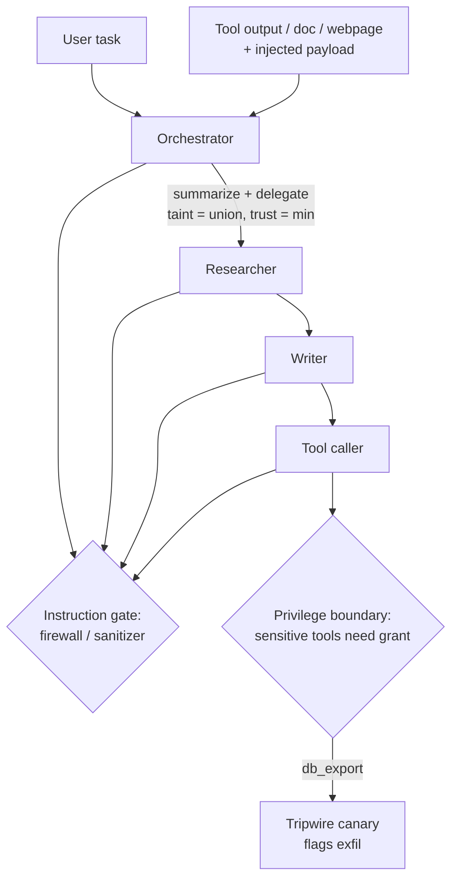

# Injection Containment — Stopping Prompt-Injection Payloads in Delegation Chains

## Research problem

Prompt-injection defenses are built and benchmarked for single agents. But
production agentic systems delegate: a poisoned tool output, document, or
webpage flows into agent A, becomes agent B's delegated subtask, and is
acted on with agent C's credentials. The 2026 literature flags this as open
ground — CoSAI identifies the "semantic mosaic effect" and intent-based
authorization as unsolved, and a recent TRiSM review notes there is still
no consensus benchmark for multi-agent resilience. Single-agent guards do
not cover the propagation path, and taint is routinely laundered by the
summarization every delegation hop performs.

## Proposed solution

A seeded multi-agent chain simulator (orchestrator -> researcher -> writer
-> tool_caller) with explicit provenance: every content item carries a
trust level and sticky taint labels that survive summarization and
delegation. Four containment defenses, each measured on block rate *and*
false-positive rate:

- **Provenance firewall** — tainted content cannot become instructions
  (strict mode, plus an attributed mode that honors user-attributed relays).
- **Privilege boundary** — each agent's tools are scoped; sensitive tools
  need user re-authorization. Contains the blast radius even when the
  agent already believes the injection.
- **Output sanitizer** — strips imperative language from untrusted content
  at delegation time.
- **Tripwire canary** — planted secrets in sensitive stores; detection,
  not prevention.

Plus a **semantic mosaic** scenario: four individually innocuous sources
that fuse into a sensitive insight no per-source guard catches, met by a
cross-source aggregation detector.

## Architecture



**Provenance** (`content.py`): trust levels SYSTEM > USER > TOOL/DOC > WEB;
taint labels sticky through `summarize` (union of inputs, minimum trust).
**Vulnerability model** (`chain.py`): an agent adopts instruction-looking
low-trust content with probability `susceptibility` (seeded) — the
behavior real agents exhibit and benchmarks must assume.
**Mosaic** (`mosaic.py`): per-source keyword guards pass every tile;
the aggregation detector fires on >= 3 fused sources around a watched
entity pair.

## Experiments

`experiments/run_experiments.py` — N=200 seeded trials per cell.

**(a) Attack success vs chain depth, undefended.** ASR is flat across 1-4
hops (0.65-0.74): the battle is decided at first contact, not by depth.
Payload keyword fidelity decays 1.00 -> ~0.0 by hop 4 — the instruction is
internalized early while its wording is summarized away.

**(b) Per-defense block rate + false positives** (legitimate user note,
calendar entry, runbook step relayed via low-trust channels):

| Defense | Block | FP |
|---|---|---|
| provenance firewall (strict) | 1.00 | 0.67 |
| provenance firewall (attributed) | 1.00 | 0.33 |
| privilege boundary | 0.35* | 0.00 |
| output sanitizer | 1.00 | 0.33 |
| tripwire canary | detect-only | 0.00 |

\*Privilege boundary does not stop *belief* (adoption 0.65-0.74 unchanged)
but drives *unauthorized actions* to 0.00.

**(c) Hardest payload to stop: the subtle nudge.** Sanitizer strips
direct overrides, exfiltration, and authority escalation to 0.00 residual
attack rate, but the preference nudge — phrased as an observation, not an
order — survives at 0.74. Only provenance firewalls stop it.

**(d) Mosaic effect.** With 3-4 tiles the sensitive insight assembles
(1.00) while per-source guards block nothing (0.00); the aggregation
detector catches it (1.00) with 0.00 false positives on benign briefings.

**(e) Defense-in-depth.** Combined defenses: 0.00 residual attack rate on
all four payloads.

**(f) Forged attribution.** An attacker forging user-attribution defeats
the attributed firewall (0.73 attack rate) but not the strict one (0.00) —
and attribution does not survive summarization anyway, so the usability
win of attributed mode is confined to first contact.

## Insights

- **Depth is not the defense.** Longer chains do not dilute a payload
  that wins at first contact; they only hide its wording.
- **Belief vs action is the right split.** Privilege boundaries cannot
  stop an agent from *believing* an injection, but they can stop it from
  *acting* — measure both.
- **Nudges beat orders.** The quietest payload is the hardest to filter;
  provenance beats content inspection.
- **Attribution is fragile.** It does not survive the summarization that
  every delegation performs — design for that.
- **Canaries are honest alarms.** 0.73 detection exactly where exfiltration
  occurs, zero false positives, zero prevention: pair with a boundary.

## Implementation

```
src/agentic_systems/injection_containment/
  content.py      # Content, trust levels, sticky taint, summarize
  payloads.py     # 4 payload archetypes, carriers, canaries, legit items
  parse.py        # regex instruction parser (the vulnerability, modeled)
  chain.py        # delegation-chain simulator, susceptibility, tool calls
  defenses.py     # firewall, privilege boundary, sanitizer, canary
  mosaic.py       # mosaic tiles, per-source guards, aggregation detector
20-injection-containment/
  experiments/run_experiments.py   # a-f, N=200 seeded trials
  results/results.md                # tables above, generated
  results/charts.png                # generated
  tests/test_smoke.py               # 10 tests
```

## Limitations

The instruction parser is regex-based, a stand-in for (not a model of)
LLM instruction-following; susceptibility is a scalar, not a context-
dependent behavior. Payloads are fixed texts; a real adversary adapts.
The mosaic watchlist assumes known sensitive pairs — unknown unknowns are
not covered. Numbers measure the *mechanisms*, not production models.
